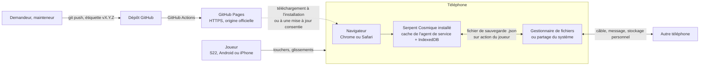
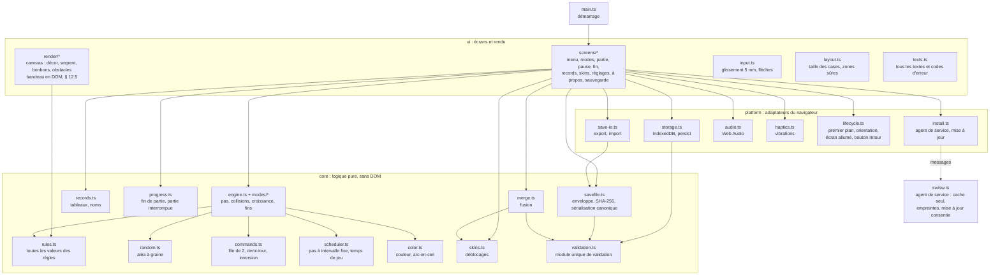
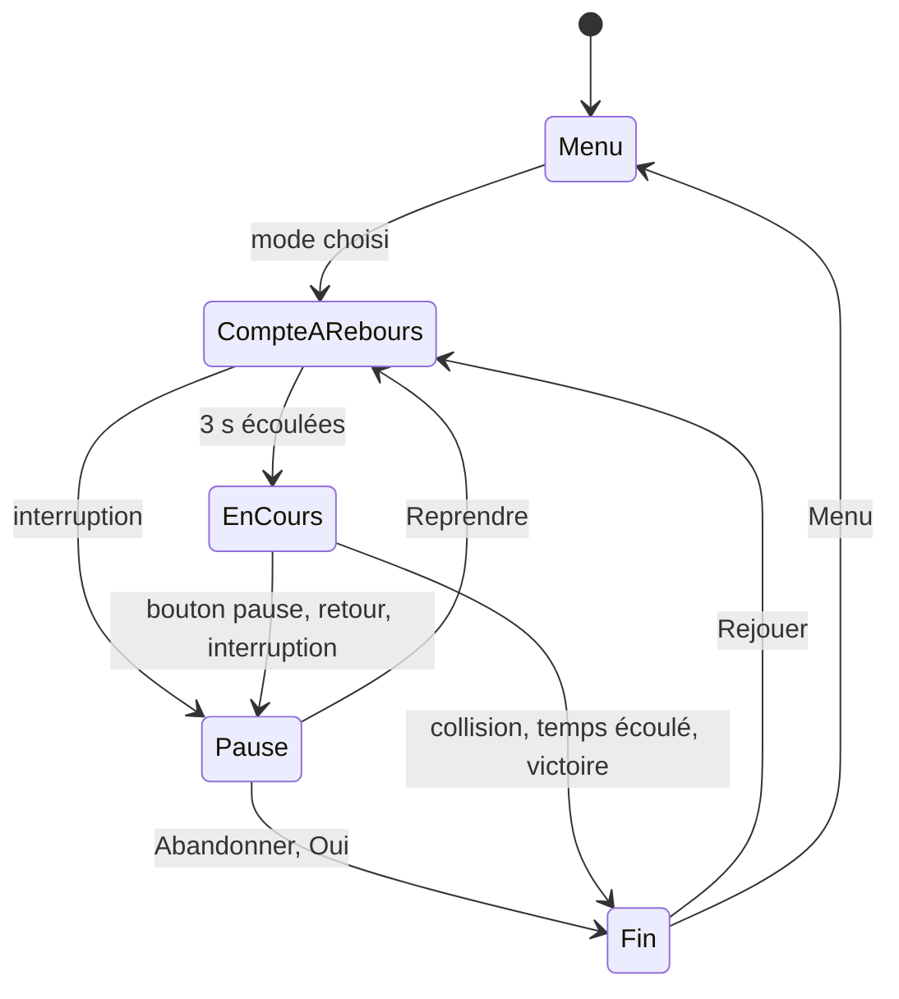
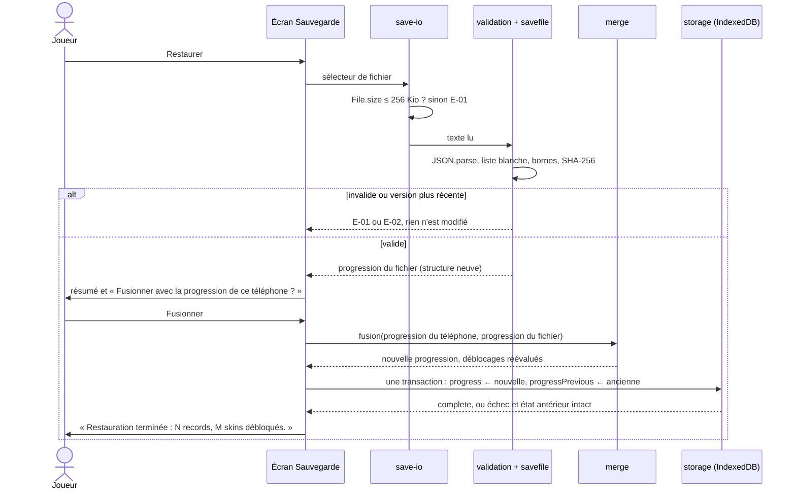

# Dossier d'architecture technique — Serpent Cosmique

| Version | Date | Sources |
|---|---|---|
| 1.0 | 2026-11-01 | 01 v1.0, 02 v1.0, 04 (cadrage) |
| 1.1 | 2026-11-02 | 02 v1.1 (EF-29, ENF-09, ENF-16, RG-10, RG-63, RG-64, RG-68, RG-72, RG-81, RG-85 modifiées), 01 (HYP-32) : écarts du § 12.2 intégrés, HYP-29 confirmée, plafond de 10 Ko par ouverture connectée pris en compte (ADR-04, R-04) ; aucune décision remplacée |
| 1.2 | 2026-11-02 | Revue de conception de sécurité (04 § 2.4, § 2.5, verdict APPROUVE_AVEC_RESERVES) : ADR-04 remplacée par ADR-07 (argument de sécurité corrigé, décision inchangée) ; EXS-17, EXS-18, EXS-19 et EXS-20 intégrées (§ 5.1, § 5.5, § 6, § 8, § 9, § 10) ; vérification obligatoire de l'origine dédiée avant la première publication (R-08) ; outil de test d'accessibilité `@axe-core/playwright` ajouté (§ 9, § 11) |
| 1.3 | 2026-11-02 | Revue de code de LOT-02 (constat 8) : écarts acceptés consignés au § 12.5 et signalés aux § 3, § 3.1, § 5.1, § 9 et § 10 (bandeau du jeu en DOM, pas d'interpolation du dessin entre deux pas, gestes et bouton pause pris à `pointerdown`, tests du moteur dans `tests/unit/`) ; aucune décision remplacée, aucune section renumérotée |

## 1. Synthèse des décisions
| Sujet | Décision | ADR |
|---|---|---|
| Forme de la solution | Application web progressive (PWA) installable sur l'écran d'accueil, entièrement locale après l'installation (forme F2) ; un seul code pour Android et iPhone | ADR-01 |
| Pile technique | TypeScript strict compilé par `tsc`, sans aucune dépendance à l'exécution ; Canvas 2D pour l'aire de jeu, DOM construit par `textContent` pour les écrans ; Web Audio ; IndexedDB ; tests `node:test` et Playwright | ADR-02 |
| Distribution et installation | Site statique publié par la CI sur GitHub Pages (HTTPS) ; installation depuis le téléphone par « Installer l'application » (Chrome, Android) ou « Sur l'écran d'accueil » (Safari, iPhone) ; archive du site, `SHA256SUMS` et SBOM CycloneDX attachés à chaque version | ADR-03 |
| Mise à jour | Jamais automatique : une nouvelle version publiée est signalée dans « À propos » et ne s'installe que si le joueur touche « Installer » ; fichiers vérifiés par empreinte SHA-256 avant d'être utilisés ; progression conservée | ADR-07 |
| Stockage de la progression | IndexedDB de l'origine : deux emplacements (version courante et dernière version lisible) et la partie en cours, écrits en une transaction atomique | ADR-05 |
| Ressources graphiques et sonores | Dessinées et synthétisées par le code ; police du système ; aucun fichier tiers sous licence | ADR-06 |

### 1.1 Réponses aux points de cadrage (04 § 1.5)
| Point | Réponse retenue |
|---|---|
| Installation gratuite sur iPhone sans magasin d'applications | Seule voie gratuite, sans ordinateur et sans expiration : l'application web ajoutée à l'écran d'accueil depuis Safari (iOS 17 ou ultérieur). Les autres voies sont écartées : TestFlight (compte payant, versions valables 90 jours), signature gratuite depuis un Mac (ordinateur requis, expiration à 7 jours), magasins alternatifs de l'Union européenne (compte développeur payant), certificat d'entreprise et débridage (interdits par 04 § 1.5). |
| Installation sur Android, Samsung Galaxy S22 prioritaire | La même application web, installée par Chrome (préinstallé sur le S22) ou Samsung Internet. Le navigateur crée une vraie icône d'application, sans « sources inconnues » ni mode développeur. Un paquet APK hors magasin est écarté : clé de signature à protéger, autorisation « applications inconnues » et vérification obligatoire des développeurs Android, déjà appliquée dans plusieurs pays depuis septembre 2026 et annoncée partout pour 2027 (délai de 24 heures ou ADB pour une application non vérifiée). |
| Fonctionnement durable sans renouvellement (ENF-01, ENF-18, HYP-25) | Rien n'expire : ni certificat, ni profil, ni compte sur le téléphone. Les fichiers du jeu sont dans le cache de l'agent de service (service worker) et la progression dans IndexedDB ; le jeu demande au navigateur de conserver ces données durablement (`navigator.storage.persist()`). Le jeu installé continue de fonctionner même si le site de publication disparaît. |
| Politique de mise à jour cohérente avec HYP-04 | Mise à jour proposée, jamais imposée (ADR-07) : l'agent de service d'une nouvelle version refuse de s'installer tant que le joueur n'a pas touché « Installer ». Sur iPhone, c'est aussi la seule façon de changer de version sans perdre la progression : supprimer puis rajouter l'icône efface les données de l'application. |

### 1.2 Faits du besoin qui conditionnent l'architecture
| Fait | Source | Conséquence |
|---|---|---|
| 1 joueur principal sur S22, 1 à 2 amis Android ou iPhone de moins de 5 ans, à l'aise avec un téléphone | 01 § 3, ENF-03 | une seule solution pour les deux systèmes, installée depuis le téléphone seul |
| Aucune connexion pendant le jeu ; une seule à l'installation | 01 § 6, OBJ-01, ENF-09 | tout est embarqué ; agent de service en « cache seul » |
| Budget nul, ni magasin, ni compte pour les joueurs | 01 § 7, ENF-01 | hébergement statique gratuit, aucune inscription des joueurs |
| Données C0 et C1 seulement, sur le téléphone, sans compte | 01 § 5, 04 § 1.3 | stockage local du navigateur, sans chiffrement au repos ; aucun serveur |
| Plusieurs joueurs sur un même téléphone, sans profils | RM-05, RG-82 | une seule progression par installation |
| Fichier de sauvegarde transférable, entrée non fiable | BES-15, EXS-04, EXS-05 | module unique de validation, fusion atomique |
| Volumétrie minime : 70 records, 16 skins, fichier ≤ 50 Ko | ENF-08 | aucune base de données ; un document JSON |
| 5 ans sans maintenance, pas de mise à jour automatique | ENF-18, HYP-04 | aucune expiration ; mise à jour consentie |
| Fluidité sur S22 (120 Hz), démarrage < 3 s | ENF-05, ENF-06 | Canvas 2D, code léger (quelques centaines de Ko), pas de moteur de jeu |

## 2. Contexte

Le jeu ne parle à aucun service. La seule liaison réseau est celle de l'installation et des mises à jour acceptées par le joueur, depuis l'origine officielle en HTTPS. Quand le téléphone est connecté, le navigateur vérifie aussi à l'ouverture du jeu si le fichier de l'agent de service a changé (ADR-07) : 10 Ko au plus par ouverture (ENF-09), sans aucune donnée du joueur. En mode avion, aucun échange n'a lieu. Le fichier de sauvegarde ne sort du téléphone que par les moyens du système, à l'initiative du joueur.

## 3. Composants


| Composant | Responsabilité | Testé par |
|---|---|---|
| `core/rules.ts` | Seul endroit des valeurs des règles (ENF-19) : grille 24 × 12, position de départ, vitesses, durées, seuils, nombre d'obstacles, couleurs et silhouettes, modes, catalogue et conditions des 16 skins, limites du dictionnaire (02 § 5.1), conversion millimètres → pixels CSS | tests unitaires |
| `core/random.ts` | Générateur pseudo-aléatoire à graine (32 bits, de type mulberry32) ; graine tirée par `crypto.getRandomValues`, ou fournie par le paramètre d'adresse `?seed=` pour la recette (ENF-19). Tous les tirages d'une partie passent par lui, dans un ordre fixe | tests unitaires |
| `core/engine.ts`, `core/modes/*.ts` | État de la partie et fonction de pas : déplacement, croissance, collisions, traversée (Zen), placement des bonbons, fins (collision, temps écoulé, victoire, abandon). Chaque mode décrit ses différences dans un objet de règles (vitesse, bords, corps, nombre de bonbons, actions à l'apparition et au repas). Le moteur émet des événements (`eat`, `special`, `effect-end`, `constellation`, `end`) que l'interface traduit en sons, vibrations et écritures | tests unitaires avec graine et temps simulé |
| `core/commands.ts` | File de 2 commandes, demi-tour et répétition ignorés, inversion (RG-25, RG-26, RG-27, RG-36) | tests unitaires |
| `core/scheduler.ts` | Transforme le temps écoulé entre deux images en pas à intervalle fixe (1 000 / vitesse ms) ; ne compte que le temps de jeu (pause et comptes à rebours exclus) ; le dessin n'interpole pas entre deux pas (écart n° 2 du § 12.5) ; ne rattrape jamais de pas après une reprise | tests unitaires à 60 Hz et 120 Hz simulés (ENF-06) |
| `core/color.ts` | Rose au départ, couleur du dernier bonbon, arc-en-ciel à chaque dizaine (RG-16, RG-17, RG-18, RG-19, RG-20) | tests unitaires |
| `core/records.ts` | Insertion au tableau (RG-46, RG-47, RG-48, RG-53), nettoyage du nom (RG-51) avec `Intl.Segmenter` (12 graphèmes) | tests unitaires |
| `core/skins.ts` | Évaluation des conditions de déblocage, choix par catégorie, union sans retrait (RG-54, RG-55, RG-56, RG-57, RG-58, RG-59, RG-60) | tests unitaires |
| `core/progress.ts` | Valeurs par défaut, application d'une fin de partie (compteurs, record, déblocages, mode mystère), clôture d'une partie interrompue (RG-45, RG-79) | tests unitaires |
| `core/validation.ts` | Module unique de validation (EXS-04) : progression locale au démarrage, partie en cours, fichier importé | tests unitaires sur corpus piégé et mutations |
| `core/savefile.ts` | Enveloppe versionnée, sérialisation canonique, somme SHA-256 (Web Crypto), nom du fichier | tests unitaires |
| `core/merge.ts` | Fusion de deux progressions validées en une nouvelle structure (RG-70, EXS-05) | tests unitaires |
| `platform/storage.ts` | IndexedDB : lecture validée, écritures atomiques, repli sur la dernière version lisible (RG-84), `persist()` | tests Playwright |
| `platform/save-io.ts` | Export par sélecteur d'enregistrement, partage ou téléchargement ; import par sélecteur de fichier avec contrôle de taille avant lecture | tests Playwright |
| `platform/audio.ts` | Bruitages et musique synthétisés, chaque catégorie selon son réglage, suspendus hors premier plan | tests Playwright (contexte audio simulé) |
| `platform/haptics.ts` | Détection et appel de `navigator.vibrate` (RG-63) | tests Playwright |
| `platform/lifecycle.ts` | Pause automatique (`visibilitychange`, `pagehide`, `blur`, orientation verticale), maintien de l'écran allumé (Screen Wake Lock), bouton retour (entrée d'historique pendant la partie) | tests Playwright |
| `platform/install.ts` | Enregistrement de l'agent de service, état « Prêt à jouer hors ligne », version disponible, consentement et mise à jour, invite d'installation Android | tests Playwright |
| `sw/sw.ts` | Agent de service : pré-cache vérifié par empreintes, réponses depuis le cache uniquement, installation d'une nouvelle version conditionnée au consentement | tests Playwright |
| `ui/*` | Écrans en DOM construits avec `textContent` ; aire de jeu sur canevas ; bandeau de la partie (score, informations du mode, bouton pause) en DOM, au-dessus du canevas (écart n° 1 du § 12.5) ; disposition paysage avec zones sûres | tests Playwright |

### 3.1 Cycle d'une partie

- La boucle d'affichage suit `requestAnimationFrame` ; le moteur avance par pas entiers selon `scheduler.ts` ; le dessin montre la position du dernier pas, sans interpolation entre deux pas (écart n° 2 du § 12.5, accepté en LOT-02 ; la conception initiale prévoyait une interpolation pour la fluidité à 120 Hz).
- Tous les temps du jeu (chrono, effets, durée de vie du bonbon spécial) sont comptés en temps de jeu : ils sont figés en pause et pendant les comptes à rebours (RG-30, RG-37, RG-75).
- À l'entrée en pause, la file de commandes est vidée, la musique s'arrête et la partie en cours est écrite (RG-79) ; elle l'est aussi à chaque bonbon mangé.

### 3.2 Disposition et mesures physiques
Aucune API du navigateur ne donne la taille physique de l'écran. Le jeu utilise une constante prudente de `rules.ts` : 1 mm ≈ 6,3 pixels CSS (1 pixel CSS mesure de 0,156 mm sur iPhone à 0,18 mm sur S22). Elle sert au seuil de glissement (5 mm), aux flèches (12 mm), au bouton pause (9 mm) et au contrôle des cases (ENF-04). La grille prend la plus grande taille entière de case qui tient dans la zone sûre (`env(safe-area-inset-*)`, `viewport-fit=cover`), une fois retirés le bandeau et, en mode « Flèches », deux colonnes de flèches de part et d'autre (haut et bas d'un côté, gauche et droite de l'autre). Calcul de contrôle : S22 en paysage (environ 780 × 360 px CSS), cases de 25 px, soit 4,5 mm ; iPhone SE de 3e génération (667 × 375 px CSS) avec flèches, cases de 21 px, soit 3,3 mm. La conception UX fixe l'agencement définitif dans ces limites ; les mesures réelles sont relevées en recette (risque R-13).

## 4. Données
### 4.1 Modèle
Les entités sont celles du dictionnaire (02 § 5.1). Représentation en TypeScript (identifiants anglais) :

| Entité | Champs (types) |
|---|---|
| `ProgressData` | `records` : objet à 7 clés fixes (identifiants de mode) → liste de `Record` (0 à 10) ; `lastName` : texte (0 à 12 graphèmes) ; `skins` : `{ unlocked: string[], selected: { shape, pattern, trail, decor } }` ; `counters` : `{ totalCandies: entier, gamesByMode: objet à 7 clés → entier }` ; `settings` : `{ control: "swipe" \| "arrows", sounds: booléen, music: booléen, vibrations: booléen }` |
| `Record` | `name` (1 à 12 graphèmes), `score` (entier 1 à 9 999), `dateTime` (date et heure locales `AAAA-MM-JJTHH:MM:SS`) |
| `PendingGame` | `mode`, `score` (0 à 9 999), `candiesEaten` (0 à 288), `dateTime` |
| `Envelope` | `format` (`"serpent-cosmique-sauvegarde"`), `formatVersion` (entier, 1 en version 1.0.0), `createdAt`, `data` (`ProgressData`), `checksum` (SHA-256 en hexadécimal) |

La même enveloppe sert au stockage local et au fichier de sauvegarde : un seul format, un seul validateur.

Exemple de fichier (abrégé) :
```json
{
  "format": "serpent-cosmique-sauvegarde",
  "formatVersion": 1,
  "createdAt": "2026-11-01T14:30:05",
  "data": {
    "records": { "classic": [{ "name": "Coco", "score": 42, "dateTime": "2026-11-01T14:02:11" }], "time-attack": [], "asteroids": [], "black-hole": [], "bonus-traps": [], "zen": [], "constellation": [] },
    "lastName": "Coco",
    "skins": { "unlocked": ["shape-rings", "pattern-plain", "trail-none", "decor-starry-night"], "selected": { "shape": "shape-rings", "pattern": "pattern-plain", "trail": "trail-none", "decor": "decor-starry-night" } },
    "counters": { "totalCandies": 42, "gamesByMode": { "classic": 1, "time-attack": 0, "asteroids": 0, "black-hole": 0, "bonus-traps": 0, "zen": 0, "constellation": 0 } },
    "settings": { "control": "swipe", "sounds": true, "music": true, "vibrations": true }
  },
  "checksum": "9f2c…"
}
```

### 4.2 Somme de contrôle
`checksum` = SHA-256 (`crypto.subtle.digest`) de la sérialisation canonique de `{ format, formatVersion, createdAt, data }` : `JSON.stringify` d'objets reconstruits dans un ordre de clés fixe, listes de skins triées. À la lecture, le validateur reconstruit cette structure à partir des seules valeurs validées, recalcule la somme et la compare. Toute valeur modifiée est détectée. Une falsification délibérée avec recalcul reste possible et n'a d'effet que sur la progression de son auteur (04 § 1.3).

### 4.3 Stockage local
| Élément | Choix |
|---|---|
| Emplacement | IndexedDB de l'origine du jeu : base `serpent-cosmique`, magasin `kv`. Sur Android, données du site dans le profil du navigateur (partagées par l'onglet et l'application installée) ; sur iPhone, conteneur propre à l'application de l'écran d'accueil |
| Clés | `progress` (enveloppe courante), `progressPrevious` (dernière enveloppe lisible), `pendingGame` (partie en cours, absente hors partie) |
| Écriture | Chaque modification (fin de partie, nom validé, réglage, choix de skin, restauration) écrit en une transaction `readwrite` (durabilité `strict` si le navigateur la propose) la nouvelle enveloppe dans `progress`, l'ancienne dans `progressPrevious` et, si besoin, supprime `pendingGame`. L'écran de fin ne s'affiche qu'après l'événement `complete` (RG-45, ENF-14). Une transaction interrompue est annulée par le navigateur : l'état reste celui d'avant |
| Partie en cours | `pendingGame` écrit à chaque bonbon mangé et à chaque mise en pause (RG-79). Au démarrage, une partie en cours trouvée est clôturée comme « Partie abandonnée » dans une transaction qui met à jour `progress` et supprime `pendingGame` : elle ne peut être comptée deux fois (EF-27 CA-3) |
| Lecture au démarrage | `progress` validée ; si elle est invalide, `progressPrevious` validée ; sinon valeurs par défaut et message E-05 (RG-84) |
| Persistance | `navigator.storage.persist()` à chaque lancement tant qu'elle n'est pas accordée (EXS-14). Chrome l'accorde aux applications installées ; Safari selon ses critères, dont l'ajout à l'écran d'accueil |
| Migration | `formatVersion` vérifié (1 à la version connue). En 1.0.0, il n'existe qu'un format : aucune migration n'est écrite. La première migration sera écrite avec le premier changement de format : validation selon l'ancien schéma, transformation, puis validation selon le schéma courant (04 § 1.5.3) |
| Chiffrement | Aucun : données C0 et C1, dans l'espace privé du navigateur (04 § 1.4, exigence écartée) |
| Conservation, effacement | Jusqu'à la désinstallation ou l'effacement des données du site ; aucune suppression par le jeu (section 7.4) |

### 4.4 Limites
- Fichier importé : 256 Kio au plus, contrôlés sur `File.size` avant toute lecture, puis sur la longueur du texte lu (EXS-04, RG-72 v1.1 : 262 144 octets). Un fichier valide fait au plus 50 Ko (ENF-08), donc aucun fichier légitime n'est refusé.
- Compteurs : entiers sûrs de 0 à 1 000 000 000 ; scores de 1 à 9 999 ; dates valides, postérieures au 01/01/2026 et au plus 24 heures après l'heure du téléphone (tolérance pour un transfert entre fuseaux horaires).

## 5. Interfaces et flux
### 5.1 Entrées et sorties
| Interface | Sens | Format, API | Remarque |
|---|---|---|---|
| Écran tactile | entrée | Pointer Events (`pointerdown`, `pointermove`) | glissement : commande dès 5 mm, une par contact ; flèches et bouton pause : pris à `pointerdown`, clavier par `click` avec `detail === 0` (écart n° 3 du § 12.5) |
| Bouton retour Android | entrée | entrée d'historique ajoutée au début de la partie, `popstate` → pause | EF-25 CA-3 |
| Fichier de sauvegarde importé | entrée non fiable | `<input type="file">`, `File.size`, `File.text()` | nom du fichier ignoré (EXS-13) |
| Paramètre `?seed=<entier>` | entrée de recette | lu une fois au lancement d'une partie ; accepté seulement s'il correspond à `^[0-9]{1,10}$` et vaut au plus 4 294 967 295, sinon ignoré sans message ; aucun autre paramètre ni le fragment de l'adresse n'est lu ; jamais inséré dans le DOM (EXS-17) | rejoue une partie à l'identique (ENF-19) ; n'agit que sur la partie locale |
| Aire de jeu, écrans | sortie | Canvas 2D pour l'aire de jeu ; DOM par `textContent` pour les écrans et le bandeau de la partie (écart n° 1 du § 12.5) | aucun HTML construit à partir de données |
| Sons | sortie | Web Audio (oscillateurs, enveloppes), contexte suspendu hors premier plan | aucun fichier audio |
| Vibrations | sortie | `navigator.vibrate(300)` et `navigator.vibrate(80)` | absent sur iPhone : réglage grisé (RG-63) |
| Fichier de sauvegarde créé | sortie | `serpent-cosmique-sauvegarde-AAAA-MM-JJ-HHMM.json` (suffixe `-N` si ce nom a déjà été produit pendant la session ; le système ajoute aussi son propre suffixe plutôt que d'écraser un fichier) | voir 5.3 |

### 5.2 Fonctions du navigateur utilisées et repli
| Fonction | Android (Chrome, Samsung Internet) | iPhone (Safari, iOS 17 et plus) | Repli |
|---|---|---|---|
| Agent de service, Cache Storage, IndexedDB, Web Crypto, `Intl.Segmenter` | oui | oui | aucun nécessaire |
| Installation sur l'écran d'accueil | « Installer l'application » ; invite `beforeinstallprompt` | Partager > « Sur l'écran d'accueil » | instructions affichées dans le jeu ouvert dans le navigateur |
| Orientation paysage imposée | oui (manifeste, application installée) | non | message « Tournez votre téléphone à l'horizontale » et pause (RG-81, admis par EF-28 CA-2) |
| Écran maintenu allumé (Screen Wake Lock) | oui | oui à partir d'iOS 18.4 dans une application de l'écran d'accueil | sinon, l'écran peut se verrouiller en Zen sans toucher : la partie passe en pause (risque R-01) |
| Vibrations | oui | non | réglage grisé « Non disponible sur ce téléphone » |
| Enregistrement du fichier | sélecteur `showSaveFilePicker` (Chrome 149 et plus) ; sinon téléchargement dans Téléchargements | partage du système (`navigator.share` avec fichier) : « Enregistrer dans Fichiers » | téléchargement |
| Persistance des données | `navigator.storage.persist()` | `navigator.storage.persist()` | fichier de sauvegarde |

### 5.3 Création d'une sauvegarde
1. Le jeu construit l'enveloppe à partir de la progression courante validée (EXS-13 : uniquement les champs du schéma).
2. Choix du moyen : `showSaveFilePicker` s'il existe ; sinon partage si `navigator.canShare({ files })` est vrai et que le téléphone n'est pas un Android ; sinon téléchargement.
3. Résultats : succès → « Sauvegarde créée : <nom> » ; annulation (`AbortError`) → aucun message ; `QuotaExceededError` → E-03 ; autre erreur → E-04. La progression n'est jamais modifiée. Seul le sélecteur rapporte un manque de place : par partage ou téléchargement, c'est le système qui affiche l'échec (risque R-07).

### 5.4 Restauration


### 5.5 Frontières de confiance
| Frontière | Données qui la franchissent | Contrôle |
|---|---|---|
| Fichier importé → jeu | texte JSON non fiable | taille avant lecture, `JSON.parse` seul, validateur en liste blanche, SHA-256, refus total (EXS-04) |
| Stockage local → jeu | progression peut-être corrompue | même validateur au démarrage, repli (RG-84) |
| Saisie du nom → jeu | texte libre | nettoyage RG-51, affichage par `textContent` ou `fillText` (EXS-06) |
| Origine officielle → téléphone | fichiers du jeu à l'installation et aux mises à jour | HTTPS, même origine, réponses mises en cache seulement si conformes et d'empreinte SHA-256 correcte, consentement (EXS-08, EXS-16, EXS-17). Ces contrôles empêchent une mise à jour non voulue et l'usage d'une version incomplète ou corrompue en transit. Ils ne protègent pas d'une publication compromise : le `sw.js` et ses empreintes viennent de la même origine, et un `sw.js` malveillant ignorerait le consentement. Cette protection relève du compte et du dépôt (ligne suivante) |
| Dépôt → publication | code et artefacts | CI seule, branche principale et étiquettes protégées, environnement de publication limité aux étiquettes `v*`, authentification à plusieurs facteurs, origine dédiée vérifiée, workflows durcis, permissions minimales (EXS-11, EXS-15, EXS-16, EXS-19, EXS-20) |
| Autres contenus de la même origine → jeu | IndexedDB, Cache Storage, messages à l'agent de service | aucun autre site Pages sur le compte, vérifié avant la première publication (EXS-19) ; messages à l'agent de service filtrés (EXS-17) |
| Pages web ouvertes, réseau local → serveur de développement | requêtes vers `scripts/serve.mjs` | 127.0.0.1, `GET` et `HEAD` seules, chemins confinés à `dist/`, en-tête `Host` contrôlé (EXS-18) |

## 6. Architecture de sécurité
| EXS | Mécanisme retenu | Composant | Lot |
|---|---|---|---|
| EXS-01 | Aucun secret nécessaire : pas de paquet signé, donc pas de clé ; publication sur Pages par jeton OIDC éphémère (`id-token: write`), sans jeton stocké. `.gitignore` (dépendances, `dist/`, fichiers `.env*`). gitleaks sur tout l'historique en CI | dépôt, CI | LOT-01, LOT-05 |
| EXS-02 | Politique `connect-src 'none'` : la page ne peut émettre aucune requête. Agent de service en « cache seul » : toute ressource absente du pré-cache reçoit une réponse d'erreur, jamais de réseau. Règles ESLint et Semgrep interdisant `fetch`, `XMLHttpRequest`, `WebSocket`, `EventSource`, `navigator.sendBeacon` et les URL absolues. Police du système, sons synthétisés, graphismes dessinés (ADR-06). Test Playwright qui compte les requêtes de la page et de l'agent de service pendant une partie, une sauvegarde et une restauration | `index.html`, `sw.ts`, `eslint.config.js`, `.semgrep.yml` | LOT-01, LOT-05 |
| EXS-03 | Seules API sans invite : `navigator.vibrate`, `navigator.wakeLock`, sélecteur de fichiers, partage, téléchargement, `navigator.storage.persist()` (sans invite sur les navigateurs visés). Règle ESLint interdisant `Notification`, `geolocation`, `mediaDevices`, `clipboard`, `contacts`, `bluetooth`, `usb`. Aucun paquet Android produit : l'icône Android est créée par le navigateur, sans permission déclarée par le jeu | `platform/*`, `eslint.config.js` | LOT-04, LOT-06 |
| EXS-04 | `core/validation.ts`, module unique, sans DOM : (1) 256 Kio au plus, contrôlés sur `File.size` puis sur la longueur du texte ; (2) `JSON.parse` seul ; (3) `format` exact et `formatVersion` entier de 1 à la version connue, E-02 au-delà ; (4) SHA-256 recalculée (§ 4.2) ; (5) liste blanche : ensemble exact des clés (`Object.keys`, donc `__proto__`, `constructor`, `prototype` refusés comme clés inconnues), types exacts, `Number.isSafeInteger`, bornes du dictionnaire, modes et skins pris dans `rules.ts`, 10 records au plus par mode, dates valides ; (6) noms de 1 à 12 graphèmes, sans caractère de contrôle ni caractère bidirectionnel U+202A à U+202E et U+2066 à U+2069 ; (7) refus total au premier écart. Appliqué au fichier importé, à `progress`, `progressPrevious` et `pendingGame` | `core/validation.ts`, `core/savefile.ts` | LOT-03, LOT-06 |
| EXS-05 | Le validateur et `core/merge.ts` construisent des objets neufs, champ par champ, à partir des seules valeurs validées. Règle ESLint `no-restricted-syntax` dans ces deux fichiers : ni `Object.assign`, ni décomposition d'objet, ni clé calculée. Validation complète avant toute écriture ; une transaction IndexedDB unique remplace `progress` et `progressPrevious` ; en cas d'échec, la transaction est annulée et la progression reste intacte. Les skins débloqués sont réunis, jamais retirés | `core/merge.ts`, `platform/storage.ts` | LOT-03, LOT-06 |
| EXS-06 | Écrans construits par `ui/dom.ts` (création d'éléments et `textContent` uniquement) ; texte du canevas par `fillText`. ESLint : `no-eval`, `no-new-func`, `no-implied-eval`, `@typescript-eslint/no-implied-eval`, `no-restricted-properties` et `no-restricted-syntax` pour `innerHTML`, `outerHTML`, `insertAdjacentHTML`, `document.write`, `document.writeln`. Les mêmes motifs dans des règles Semgrep locales (`.semgrep.yml`), exécutables sans accès au registre de règles | `ui/dom.ts`, `eslint.config.js`, `.semgrep.yml` | LOT-01, LOT-03 |
| EXS-07 | Balise `<meta http-equiv="Content-Security-Policy">` en tête de `index.html` (GitHub Pages n'accepte pas d'en-têtes personnalisés) : `default-src 'self'; script-src 'self'; style-src 'self'; img-src 'self' data: blob:; media-src 'self' blob:; font-src 'self'; connect-src 'none'; worker-src 'self'; manifest-src 'self'; object-src 'none'; base-uri 'none'; form-action 'none'`. Seul écart avec la valeur de référence : `connect-src 'none'` au lieu de `'self'`, plus strict. Si les tests de la mise à jour montrent qu'il bloque `registration.update()`, on revient à `'self'`. Aucun script, style ni gestionnaire d'événement en ligne. `<meta name="referrer" content="no-referrer">`. `frame-ancestors` ne peut pas passer par une balise : le jeu refuse de démarrer s'il est affiché dans un cadre (`window.top !== window.self`). Aucun cookie | `public/index.html`, `src/main.ts` | LOT-01 |
| EXS-08 | GitHub Pages en HTTPS imposé (domaine `github.io` préchargé HSTS, TLS 1.2 au moins). Agent de service enregistré par chemin relatif ; le navigateur ne l'accepte qu'en contexte sécurisé. Pré-cache limité aux fichiers du site (chemins relatifs, même origine), chacun vérifié par son empreinte SHA-256 avant mise en cache | `sw.ts`, `scripts/build.mjs` | LOT-05 |
| EXS-09 | Chaque version GitHub porte l'archive `serpent-cosmique-<version>.zip` du site, `SHA256SUMS` et la SBOM CycloneDX (`npm sbom --sbom-format cyclonedx`, sans outil ajouté). Le volet « paquet signé » est sans objet : aucun APK n'est produit. Le guide donne le lien officiel unique et la vérification facultative de la somme sur ordinateur ; jamais de `curl \| sh` | `.github/workflows/release.yml` | LOT-05 |
| EXS-10 | Aucune dépendance à l'exécution. Huit outils de développement épinglés à la version exacte (§ 11), `package-lock.json` avec empreintes sha512, installation par `npm ci`, `overrides` pour `minimatch` 11.0.3. Dependabot pour npm et pour les actions. Toutes les ressources sont produites par le code (ADR-06) : leur origine et leur licence (celle du jeu) sont indiquées dans le README. `npm audit` et osv-scanner en CI | `package.json`, `.github/dependabot.yml` | LOT-01 |
| EXS-11 | `ci.yml` (push et pull request) : formatage, lint, types, tests unitaires avec couverture, construction, Playwright, osv-scanner, gitleaks, Semgrep ; `permissions: contents: read`. `release.yml` : tâche de construction en lecture seule, tâche de publication Pages avec `pages: write` et `id-token: write`, tâche de version avec `contents: write`. Actions tierces épinglées par SHA, `pull_request_target` interdit. gitleaks par son binaire publié avec somme SHA-256 vérifiée, ou par son image épinglée par condensat, jamais par `gitleaks-action` ; durcissement complémentaire en EXS-20 | `.github/workflows/*` | LOT-01, LOT-05 |
| EXS-12 | Tous les messages dans `ui/texts.ts`, en français, avec un code court (E-01, E-02, E-03, E-04, E-05, E-06) ; aucune trace d'exécution affichée ; aucun envoi. ESLint `no-console` en erreur : rien n'est écrit dans la console, donc ni nom ni contenu de sauvegarde | `ui/texts.ts`, `eslint.config.js` | LOT-03, LOT-06 |
| EXS-13 | Progression dans IndexedDB de l'origine (espace privé), jamais dans un emplacement partagé. Seul le fichier de sauvegarde sort, sur action du joueur. Son contenu est exactement l'enveloppe du § 4.1 (test d'égalité des clés), sans identifiant d'appareil ni diagnostic. Son nom est produit par le jeu ; le nom du fichier importé est ignoré | `platform/storage.ts`, `core/savefile.ts`, `platform/save-io.ts` | LOT-03, LOT-06 |
| EXS-14 | `navigator.storage.persist()` à chaque lancement tant qu'elle n'est pas accordée ; sauvegarde par fichier proposée ; aucune API de suppression de fichier n'est utilisée | `platform/storage.ts` | LOT-03 |
| EXS-15 | `SECURITY.md` et guide d'exploitation : données stockées et emplacement, aucune communication du jeu (et vérification de version par le navigateur quand le téléphone est connecté), effacement selon la plateforme (§ 7.4), contenu lisible du fichier de sauvegarde, lien officiel unique, ne pas restaurer un fichier d'origine inconnue, ne jamais supprimer l'icône pour mettre à jour (perte des données sur iPhone), authentification à plusieurs facteurs sur le compte GitHub, aucun autre site Pages sur ce compte (vérification obligatoire avant la première publication, EXS-19). Le conseil de retirer l'autorisation « applications inconnues » est sans objet (aucun APK) | `SECURITY.md`, `docs/guide-exploitation.md` | LOT-05, LOT-06 |
| EXS-16 | Publication uniquement par `release.yml`, déclenché par une étiquette `vX.Y.Z` posée sur la branche `main` protégée ; source de Pages réglée sur « GitHub Actions » (aucun dépôt manuel). L'agent de service n'exécute que les fichiers pré-cachés et vérifiés ; une nouvelle version n'est installée qu'avec le consentement du joueur (ADR-07) ; `script-src 'self'` interdit tout code d'une autre origine. Le consentement ne protège pas d'une publication compromise : c'est le rôle d'EXS-15, EXS-19 et EXS-20 | `sw.ts`, `release.yml` | LOT-05 |
| EXS-17 | (1) Validateur : toute exception (imbrication profonde, `RangeError`, `SyntaxError`) est captée et donne E-01 ; objet simple et tableau distingués partout (`Array.isArray`, prototype égal à `Object.prototype`) ; nom refusé s'il est mal formé (`isWellFormed()` faux), s'il contient un caractère de contrôle (`\p{Cc}`) ou une marque bidirectionnelle (U+061C, U+200E, U+200F, U+202A à U+202E, U+2066 à U+2069) ; U+200D admis pour les emojis composés. Le prédicat de caractères est défini une fois dans `validation.ts` et réutilisé par le nettoyage de la saisie (RG-51, `records.ts`) : un nom enregistré passe toujours le validateur au lancement suivant. Corpus complété : 100 000 crochets imbriqués, substitut isolé, U+200F, `records` ou `data` sous forme de tableau. (2) `?seed=` analysé strictement (§ 5.1). (3) Manifeste sans `share_target`, `file_handlers`, `protocol_handlers` ni `launch_handler`. (4) Agent de service : ne répond qu'aux requêtes `GET` de son origine et de sa portée ; ne met en cache qu'une réponse `ok`, de type `basic`, non redirigée, d'empreinte correcte ; ignore tout message venu des pages, aucun n'étant nécessaire (le consentement est une entrée de Cache Storage, l'état se lit par `navigator.serviceWorker.ready`) ; un message ajouté plus tard aurait un type pris dans une liste fermée et des champs validés ; n'appelle `fetch` que pendant l'installation ou la mise à jour consentie | `core/validation.ts`, `core/records.ts`, `core/random.ts`, `public/manifest.webmanifest`, `sw.ts` | LOT-01, LOT-03, LOT-05, LOT-06 |
| EXS-18 | `scripts/serve.mjs` : écoute sur 127.0.0.1 seulement ; `GET` et `HEAD` seules ; chemin décodé, refusé s'il contient un octet nul, puis résolu (`path.resolve`) et confiné à `dist/` (préfixe `dist` suivi du séparateur), sinon 404 ; liens symboliques sortant de `dist/` non suivis ; en-tête `Host` limité à `127.0.0.1:<port>` et `localhost:<port>`, sinon 421 ; aucune liste de répertoire. Aucun en-tête de sécurité que GitHub Pages n'envoie pas : les tests vérifient la balise CSP telle qu'elle sera publiée, et cette balise est le premier élément de `<head>` | `scripts/serve.mjs`, `public/index.html` | LOT-01 |
| EXS-19 | Liste de contrôle « Avant la première publication » dans le guide d'exploitation, à cocher par le mainteneur et vérifiée par `gh api` : authentification à plusieurs facteurs ; aucun autre site Pages sur le compte, sinon organisation gratuite dédiée (obligatoire, § 8) ; aucun domaine personnalisé, ou domaine vérifié avec « Enforce HTTPS » ; `main` protégée (ni poussée forcée ni suppression) ; étiquettes `v*` réservées au mainteneur, ni modifiables ni supprimables ; environnement `github-pages` limité aux étiquettes `v*` ; source de Pages « GitHub Actions » ; approbation des workflows des contributions externes ; alertes Dependabot, analyse des secrets et protection à l'envoi ; signalement privé des vulnérabilités (indiqué dans `SECURITY.md`, aucune adresse électronique publiée) ; commits avec l'adresse `noreply` et blocage des envois qui exposent l'adresse ; aucune donnée personnelle réelle dans les tests ni l'historique. `SECURITY.md` indique que GitHub reçoit l'adresse IP du téléphone à l'installation, aux mises à jour et aux vérifications de version, et que le risque d'un site ajouté plus tard sur le même compte est accepté | `docs/guide-exploitation.md`, `SECURITY.md` | LOT-05 |
| EXS-20 | `.npmrc` avec `ignore-scripts=true` (aucun script d'installation ni script `pre`/`post` : les scripts du projet ne reposent pas sur eux) et `npm ci` dans toute la CI ; Dependabot pour `npm` et `github-actions` avec `cooldown` de 7 jours (mises à jour de sécurité immédiates) ; `actions/checkout` avec `persist-credentials: false` ; aucune expression de contexte GitHub interpolée dans un `run:` (passage par variable d'environnement) ; gitleaks, Semgrep (`pip` ou `uvx` à version fixe) et osv-scanner (workflow réutilisable officiel épinglé par SHA) installés à version fixe, empreinte ou condensat vérifié. `release.yml` : aucun cache ; contrôle que l'étiquette pointe sur un ancêtre de `origin/main` (`git merge-base --is-ancestor`) ; CI au vert exigée sur le même commit ; tâche de construction sans installation de navigateurs ; artefact Pages limité à `dist/` et égal à la liste pré-cachée plus `sw.js` (la construction échoue sinon, contrôle fait par `scripts/build.mjs`) ; version créée par `gh release create`, sans action tierce | `.npmrc`, `.github/*`, `scripts/build.mjs` | LOT-01, LOT-05 |

## 7. Installation, configuration, mise à jour, désinstallation
### 7.1 Installation par le joueur (3 étapes, téléphone seul, une connexion, aucun compte, 0 €)
| Étape | Android (S22 : Chrome) | iPhone (Safari) |
|---|---|---|
| 1 | Toucher le lien officiel reçu (message) et l'ouvrir dans Chrome | Ouvrir le lien officiel dans Safari |
| 2 | Toucher « Installer » (bouton du jeu ou menu ⋮ > « Installer l'application ») | Partager > « Sur l'écran d'accueil » > « Ajouter » |
| 3 | Ouvrir le jeu depuis son icône et attendre « Prêt à jouer hors ligne » | Ouvrir le jeu depuis son icône et attendre « Prêt à jouer hors ligne » (sur iPhone, l'application de l'écran d'accueil a son propre stockage : ce premier lancement connecté est indispensable) |

Aucun droit administrateur, aucune permission demandée, aucun mode développeur. Ouvert dans le navigateur sans être installé, le jeu affiche un court panneau « Installer le jeu » adapté au téléphone détecté. Espace occupé : quelques centaines de Ko de fichiers, plus la progression (ENF-02 : 50 Mo au plus).

### 7.2 Configuration
Aucun fichier de configuration ni variable d'environnement : les réglages du joueur se font dans le jeu (EF-21) ; les valeurs des règles sont des constantes de `rules.ts` (ENF-19). L'adresse de publication n'apparaît nulle part dans le code : tous les chemins sont relatifs (`start_url`, `scope` et `id` du manifeste valent `./`), le site fonctionne donc à la racine comme dans un sous-dossier.

### 7.3 Mise à jour (ADR-07, EF-29)
1. Le mainteneur publie une version (étiquette `vX.Y.Z` sur `main`) ; la CI construit et publie.
2. À la prochaine ouverture du jeu avec une connexion, le navigateur détecte le nouvel agent de service. Celui-ci refuse de s'installer sans consentement et signale la version au jeu. « À propos » affiche « Nouvelle version X.Y.Z disponible » et le bouton « Installer » ; un repère discret apparaît sur l'accès aux réglages du menu principal (RG-89). Rien ne s'affiche pendant une partie (EF-29 CA-4) ; en mode avion, ni proposition ni erreur (EF-29 CA-5).
3. Le joueur touche « Installer » : le jeu enregistre le consentement pour cette version et relance la vérification. Le nouvel agent de service télécharge les fichiers, vérifie leurs empreintes puis remplace l'ancien, et le jeu se recharge : « Serpent Cosmique a été mis à jour en version X.Y.Z. Votre progression est conservée. »
4. En cas d'échec (connexion perdue, empreinte fausse), l'ancienne version reste en place : « La mise à jour n'a pas pu être installée. Votre version actuelle reste disponible. Réessayez avec une connexion. (E-06) ».

La progression, dans IndexedDB, n'est pas touchée par la mise à jour ; la nouvelle version la relit par le validateur, avec une migration si le format a changé. La mise à jour n'est proposée que depuis les menus, jamais pendant une partie.

### 7.4 Désinstallation et effacement
| Plateforme | Désinstaller | Effacer toute la progression |
|---|---|---|
| Android | appui long sur l'icône > « Désinstaller » | Chrome > Paramètres > Paramètres des sites > Toutes les données des sites > l'adresse du jeu > Effacer. Désinstaller l'icône seule peut laisser les données dans le navigateur |
| iPhone | appui long sur l'icône > « Supprimer l'app » | la suppression de l'icône efface les données de l'application |

Le jeu ne supprime jamais rien de lui-même (ni progression, ni fichier de sauvegarde).

## 8. Exploitation
- **Journaux** : aucun, par décision (ENF-16, 04 § 1.4) : rien n'est écrit dans la console et rien n'est transmis. Le diagnostic repose sur les codes d'erreur affichés (E-01, E-02, E-03, E-04, E-05, E-06) et sur « À propos » (version, état « Prêt à jouer hors ligne », version disponible).
- **Sauvegarde et restauration** : fichier de sauvegarde à la demande (EF-23, EF-24) ; recommandé avant un changement de téléphone ou une mise à jour.
- **Publication (mainteneur, une fois)** : dépôt GitHub `serpent-cosmique` (public, HYP-29), protection de la branche `main` et des étiquettes `v*`, Pages réglé sur « GitHub Actions », authentification à plusieurs facteurs. Ensuite, chaque version se publie en posant une étiquette. Adresse obtenue : `https://<compte>.github.io/serpent-cosmique/`. Les données du jeu sont rattachées à l'origine `https://<compte>.github.io`, commune à tous les sites Pages du compte. **Avant la première publication, le mainteneur vérifie obligatoirement qu'aucun autre site Pages n'est publié sur ce compte ; sinon le jeu est publié depuis une organisation gratuite dédiée** (EXS-19, risque R-08). Cette vérification ouvre la liste de contrôle « Avant la première publication » du guide d'exploitation (EXS-19). Le risque d'un site ajouté plus tard sur le même compte est accepté et signalé dans `SECURITY.md` (RSK-07 de 04).
- **Indexation** : `robots.txt` (`Disallow: /`) et `<meta name="robots" content="noindex">` : l'adresse n'est pas référencée par les moteurs de recherche.
- **Maintenance de la chaîne de construction** : Node.js 22 (fin de maintenance en avril 2027), à passer ensuite à la version LTS suivante ; Playwright est épinglé sur 1.63.0, version dont les navigateurs sont disponibles sur le poste de développement (§ 12.3). Ces outils ne servent qu'à construire et tester : le jeu installé n'en dépend pas.

## 9. Stratégie de test
| Niveau | Outil | Portée | Où |
|---|---|---|---|
| Unitaire | `node:test` (Node 22, TypeScript exécuté par retrait des types), couverture intégrée `--test-coverage-lines=80` sur `src/core` | toutes les règles de `core` : moteur et 7 modes (graine et temps simulés), commandes, couleurs, ordonnanceur à 60 Hz et 120 Hz simulés, records et noms, skins, progression, validateur (corpus piégé d'EXS-04 et mutations aléatoires reproductibles par graine), somme de contrôle, fusion (pollution de prototype, skins disjoints, idempotence), contrastes de la palette calculés selon la formule WCAG (ENF-11) | poste de développement et CI |
| Acceptation (CT-xx) | Playwright 1.63.0, `tests/acceptance/`, tests nommés par leur CT ; les CT qui portent sur les règles du moteur sont vérifiés par des tests unitaires de `tests/unit/`, nommés eux aussi par leur CT (écart n° 4 du § 12.5) | parcours dans un navigateur réel servi par `scripts/serve.mjs` (écoute 127.0.0.1) : menu et partie en 2 touchers, glissement et flèches (événements tactiles), pause et retour, pause automatique (`visibilitychange` simulé), orientation verticale (viewport 360 × 780), persistance après rechargement et fermeture du contexte (fermeture forcée simulée), hors ligne après installation (`context.setOffline`), comptage des requêtes, absence de violation CSP (`securitypolicyviolation`), mise à jour refusée sans consentement et appliquée avec (deux constructions servies successivement), export (événement de téléchargement) et import (`setInputFiles` avec le corpus), `?seed=` mal formé ignoré, message inconnu envoyé à l'agent de service sans effet, requêtes piégées vers `serve.mjs` (EXS-17, EXS-18) ; horloge maîtrisée par `page.clock` | Chromium sur le poste de développement ; Chromium et WebKit en CI |
| Accessibilité | `@axe-core/playwright` 4.14.0 dans les tests Playwright, règles WCAG 2.0, 2.1 et 2.2 niveaux A et AA | chaque écran de l'inventaire de 05 (partie DOM) analysé dans l'état où le lot le livre ; aucune violation d'impact « serious » ou « critical » admise. Le contenu du canevas n'est pas analysé par axe : ses contrastes sont calculés sur la palette (ligne Unitaire) | Chromium sur le poste de développement ; Chromium et WebKit en CI |
| Configurations | profils Playwright « Android paysage » (780 × 360, facteur 3, tactile) et « iPhone SE paysage » (667 × 375, facteur 2, tactile) | | |
| Statique | `tsc` strict (application et agent de service), ESLint (règles de sécurité du § 6), Prettier, Semgrep (règles locales, et règles du registre en CI), gitleaks, `npm audit`, osv-scanner | | poste de développement (Semgrep via `uvx`) et CI |
| Recette sur téléphone | manuel, guidé par le cahier de recette | installation chronométrée (ENF-01), mode avion et redémarrage (ENF-09), vibrations, écran allumé, rotation à 180°, appel, notification et verrouillage (EF-26), mesures physiques (ENF-04, ENF-12), fluidité par vidéo haute fréquence (ENF-06, ENF-07), espace occupé (ENF-02), contrastes perçus et tests à 3 personnes (ENF-10, ENF-11), endurance (ENF-20), transfert entre deux téléphones (SCN-04) | S22 ou Android 12+ équivalent, au moins un iPhone sous iOS 17+ |

Points d'appui pour les tests, sans code réservé à la recette : moteur pur avec graine et temps injectés ; paramètre `?seed=` ; horloge Playwright.

Non automatisable ici : comportement réel de Safari sur iPhone (WebKit de Playwright en CI en est une approximation), Samsung Internet, installation sur l'écran d'accueil, vibrations, Wake Lock, appels et notifications réels, mesures en millimètres, perception des couleurs.

## 10. Structure du code
```
./                                  racine du dépôt livré
├── README.md  CHANGELOG.md  SECURITY.md  LICENSE
├── package.json  package-lock.json  .nvmrc  .npmrc (ignore-scripts=true)
├── tsconfig.json                   application (DOM, ES2022, strict, rewriteRelativeImportExtensions, erasableSyntaxOnly)
├── tsconfig.sw.json                agent de service (WebWorker)
├── eslint.config.js  .prettierrc.json  .prettierignore  .semgrep.yml  .editorconfig  .gitignore
├── playwright.config.ts
├── public/
│   ├── index.html                  politique CSP en balise meta, aucun script en ligne
│   ├── styles.css
│   ├── manifest.webmanifest        id, start_url et scope "./", display "fullscreen", orientation "landscape"
│   ├── robots.txt
│   └── icons/                      icon.svg (source), icon-192.png, icon-512.png, icon-maskable-512.png, apple-touch-icon-180.png
├── src/
│   ├── main.ts                     démarrage : refus d'un cadre, lecture de la progression, partie interrompue, menu
│   ├── core/                       logique pure, sans DOM
│   │   ├── rules.ts  random.ts  types.ts  board.ts  commands.ts  engine.ts  scheduler.ts  color.ts
│   │   ├── modes/  classic.ts  time-attack.ts  asteroids.ts  black-hole.ts  bonus-traps.ts  zen.ts  constellation.ts
│   │   ├── records.ts  skins.ts  progress.ts  format.ts
│   │   └── validation.ts  savefile.ts  merge.ts
│   ├── platform/  storage.ts  save-io.ts  audio.ts  haptics.ts  lifecycle.ts  install.ts
│   ├── ui/
│   │   ├── dom.ts  texts.ts  input.ts  layout.ts
│   │   ├── render/  board.ts  decor.ts  snake.ts  candies.ts  obstacles.ts  hud.ts
│   │   └── screens/  menu.ts  modes.ts  game.ts  pause.ts  end.ts  records.ts  skins.ts  settings.ts  about.ts  save.ts  install-help.ts
│   └── sw/sw.ts
├── scripts/
│   ├── build.mjs                   tsc → dist/, copie de public/, empreintes SHA-256 et version injectées dans dist/sw.js
│   ├── serve.mjs                   serveur statique local (127.0.0.1) pour le développement et les tests
│   └── make-icons.mjs              produit les PNG à partir de icon.svg (une fois, résultats versionnés)
├── tests/
│   ├── unit/                       *.test.ts (node:test), à plat, un fichier par thème (moteur, commandes, ordonnanceur…), y compris les tests du moteur (écart n° 4 du § 12.5)
│   ├── acceptance/                 *.spec.ts (Playwright, nommés ct_xx_…)
│   └── fixtures/saves/             corpus de fichiers de sauvegarde valides et piégés
├── docs/  guide-installation.md  guide-utilisateur.md  guide-exploitation.md  projet/
└── .github/  workflows/ci.yml  workflows/release.yml  dependabot.yml
```
Commandes : `npm ci`, `npm run build`, `npm run lint`, `npm run typecheck`, `npm test`, `npm run test:e2e`, `npm run serve`. `dist/` n'est pas versionné.

## 11. Dépendances
Aucune dépendance à l'exécution : le jeu livré ne contient que son propre code. Outils de développement (`devDependencies`), vérifiés le 2026-11-01 :

| Dépendance | Version épinglée | Licence | Rôle | Justification | Vulnérabilités connues (source, date) |
|---|---|---|---|---|---|
| typescript | 6.0.3 (publiée le 2026-04-16) | Apache-2.0 | compilation et vérification des types | typage strict exigé ; compile en modules ES sans empaqueteur. La 7.x n'est pas encore prise en charge par typescript-eslint (`<6.1.0`) | aucune (base GitHub Advisory via `npm audit`, 2026-11-01) |
| @types/node | 22.20.5 (2026-10-01) | MIT | types de `node:test` et `node:assert` | vérification de type des tests | aucune (idem) |
| eslint | 10.14.0 (2026-10-30) | MIT | analyse statique | lint standard de la pile ; porte les règles de sécurité EXS-02, EXS-03, EXS-05, EXS-06, EXS-12 | aucune après le forçage de `minimatch` ci-dessous (idem) |
| @eslint/js | 10.0.1 (2026-02-06) | MIT | règles de base d'ESLint | configuration recommandée | aucune (idem) |
| typescript-eslint | 8.72.1 (2026-10-26) | MIT | analyse du TypeScript par ESLint | règles typées (`no-implied-eval`, promesses non attendues) | aucune après forçage (idem) |
| prettier | 3.9.10 (2026-10-10) | MIT | formatage | formateur standard de la pile | aucune (idem) |
| @playwright/test | 1.63.0 (2026-09-04) | Apache-2.0 | tests dans un navigateur réel, Chromium et WebKit | seul moyen d'automatiser agent de service, IndexedDB, hors ligne, CSP ; version liée aux navigateurs disponibles (Chromium révision 1243) | aucune (idem) |
| @axe-core/playwright | 4.14.0 (2026-10-15), avec axe-core 4.14.0 (2026-10-05) | MPL-2.0 | tests d'accessibilité automatiques des écrans | ajouté sur décision de l'équipe projet : vérifie à chaque lot les écrans DOM de 05 (noms accessibles, étiquettes, contrastes des textes, `lang`) ; compatible avec Playwright 1.63.0 (dépendance `playwright-core` ≥ 1.0.0, essai réussi sur Chromium révision 1243). La licence MPL-2.0 est admise sans réserve ; l'outil sert aux tests et n'est pas distribué avec le jeu | aucune (idem) |
| minimatch (forçage `overrides`) | 11.0.3 (2026-10-28) | BlueOak-1.0.0 (permissive) | dépendance indirecte d'ESLint | corrige GHSA-g3hv-75wg-m249 (déni de service par motifs de fichiers, modéré, versions < 11.0.1) ; vérifié : ESLint et typescript-eslint fonctionnent avec | aucune (idem) |

Arbre complet résolu : 105 paquets, aucun script d'installation ; licences MIT (73), Apache-2.0 (16), BSD-2-Clause (6), ISC (5), BlueOak-1.0.0 (2), MPL-2.0 (2), BSD-3-Clause (1), toutes compatibles avec une licence MIT du jeu (aucun de ces outils n'est distribué avec lui). `npm audit` : 0 vulnérabilité avec le forçage (vérifié le 2026-11-02, `@axe-core/playwright` compris). L'API d'osv.dev n'était pas joignable depuis le poste de développement : osv-scanner tourne en CI.

Écartés : Vite et Vitest (une cinquantaine de paquets en plus pour un serveur de développement et des tests que `tsc` et `node:test` assurent), un moteur de jeu (Phaser 4 : dépendance à l'exécution, voir ADR-02), `idb` (une couche IndexedDB de quelques dizaines de lignes suffit), Workbox (agent de service écrit à la main, plus court et lisible), une bibliothèque de validation de schéma (le validateur doit être en liste blanche stricte et reste court).

Outils de la CI hors npm (gitleaks, Semgrep, osv-scanner, actions GitHub) : versions et empreintes fixées dans les workflows.

## 12. Risques techniques et dette assumée
### 12.1 Risques
| ID | Risque | Effet | Traitement |
|---|---|---|---|
| R-01 | Wake Lock inopérant dans les applications de l'écran d'accueil avant iOS 18.4 | sur iPhone en iOS 17 à 18.3, l'écran peut se verrouiller en Zen sans toucher (RG-10, EF-02 CA-6) | la partie passe en pause sans perte (EF-26) ; limite signalée dans le guide (HYP-31) |
| R-02 | Pas d'API de vibration sur iPhone | vibrations indisponibles | réglage grisé prévu par RG-63 (HYP-31) |
| R-03 | Orientation non imposable sur iPhone | affichage vertical possible | message et pause (RG-81), admis par EF-28 CA-2 |
| R-04 | Le navigateur vérifie la version de l'agent de service quand le téléphone est connecté | échange par ouverture connectée vers l'origine officielle, plafonné à 10 Ko par ENF-09 v1.1 | requête conditionnelle (réponse 304 de quelques centaines d'octets tant que la version ne change pas) ; `sw.js` limité à 9 Ko non compressé (empreintes en base64, liste des seuls fichiers du site) pour rester sous 10 Ko même au téléchargement d'un nouveau `sw.js` ; mesuré en LOT-05 et en recette ; le jeu n'émet rien ; documenté (EXS-15, HYP-30) |
| R-05 | Effacement des données du navigateur par le joueur | perte de la progression | fichier de sauvegarde ; information dans le guide (EXS-15) |
| R-06 | Politique d'Apple sur les applications web de l'écran d'accueil dans l'Union européenne (retrait annoncé puis abandonné en 2024) | installation iPhone compromise si Apple change d'avis | aucun traitement technique possible ; la sauvegarde par fichier reste disponible |
| R-07 | Manque de place indétectable par partage ou téléchargement | E-03 ne s'affiche qu'avec le sélecteur d'enregistrement (Chrome 149 et plus) | le système signale l'échec ; la progression n'est jamais modifiée (EF-23 CA-2 vérifiable sur le S22) |
| R-08 | Origine commune à tous les sites Pages du compte | un autre site du même compte pourrait lire ou modifier les données du jeu, ou écrire dans son cache | vérification obligatoire avant la première publication : aucun autre site Pages, sinon organisation dédiée (EXS-19, § 8) ; messages à l'agent de service filtrés (EXS-17) ; site ajouté plus tard : risque résiduel accepté, signalé dans `SECURITY.md` |
| R-09 | Adresse du jeu joignable par qui la connaît, code source public (HYP-29) | diffusion plus large que prévu si le lien circule | `noindex`, `robots.txt` ; accepté par le demandeur (HYP-32 de 01) |
| R-10 | Le consentement de mise à jour repose sur le comportement normalisé des agents de service (échec d'installation sans effet sur la version active) | une mise à jour pourrait s'appliquer ou échouer de façon inattendue | vérifié sur Chromium le 2026-11-01 (maquette : version 2 refusée sans consentement après fermeture et réouverture, appliquée après consentement, jeu servi hors ligne ensuite) ; test WebKit en CI ; vérification sur iPhone en recette |
| R-11 | Écarts entre WebKit de Playwright et Safari réel ; Samsung Internet non automatisé | anomalie découverte seulement en recette | recette sur S22 et iPhone ; fonctions du navigateur détectées et dotées d'un repli (§ 5.2) |
| R-12 | Fluidité (ENF-06) mesurable seulement sur le téléphone | écart tardif | ordonnanceur testé à 60 et 120 Hz simulés ; facteur de densité du canevas plafonné à 2 si besoin ; interpolation du rendu à ajouter si la recette la juge nécessaire (écart n° 2 du § 12.5) |
| R-13 | Conversion millimètres → pixels CSS approximative | seuils de 5, 9 et 12 mm et cases de 3 ou 4 mm légèrement décalés selon l'appareil | constante prudente (§ 3.2) ; mesures en recette |

### 12.2 Écarts avec 02, intégrés en 02 v1.1
- Taille maximale du fichier importé : 256 Kio (EXS-04), reprise par RG-72 et le dictionnaire.
- Erreur E-06 « mise à jour impossible », ajoutée à ENF-16 (RG-91).
- Écran « À propos » : version disponible, bouton « Installer », messages de mise à jour, état « Prêt à jouer hors ligne », repère sur le menu, panneau « Installer le jeu » dans le navigateur : EF-29 (RG-89, RG-90, RG-91, RG-92) et RG-64. Reste à la conception UX d'en fixer la présentation.
- Suffixe `-N` de RG-68 limité aux noms produits depuis l'ouverture du jeu, le téléphone ajoutant son propre suffixe plutôt que d'écraser : repris par RG-68. Le fichier porte l'extension `.json`.
- Échanges réseau admis téléphone connecté (vérification de version, mise à jour consentie) : repris par ENF-09 et RG-85 ; limites de l'iPhone : RG-10, RG-63, RG-81 (HYP-31).

### 12.3 Dette assumée
- Playwright est épinglé sur 1.63.0, la version dont les navigateurs sont disponibles sur le poste de développement. La passer en 1.64 ou plus impose de disposer des navigateurs correspondants.
- Musique de fond synthétisée, volontairement simple (ADR-06).
- Pas de Trusted Types : l'enregistrement de l'agent de service exigerait une politique dédiée. La protection repose sur l'absence de tout point d'injection, contrôlée par ESLint et Semgrep.
- Politique CSP en balise meta, sans `frame-ancestors`, compensée par le refus de démarrer dans un cadre.

### 12.4 Hypothèses ajoutées
| ID | Hypothèse | Origine | Conséquence si elle est fausse |
|---|---|---|---|
| HYP-29 | Le demandeur publie le jeu depuis son compte GitHub gratuit, avec un dépôt public (GitHub Pages n'est gratuit que pour un dépôt public) ; l'adresse du jeu est joignable par qui la connaît, sans être référencée. Confirmée par HYP-32 de 01 : code et adresse publics une fois le projet exporté dans le dépôt du demandeur, qui reste privé jusque-là ; la première publication suit donc cet export | équipe projet, confirmée par le demandeur (HYP-32) | héberger sur Cloudflare Pages (gratuit, dépôt privé accepté) : un second compte et un jeton de déploiement à protéger dans la CI (ADR-03, option B) |
| HYP-30 | Une nouvelle version est signalée dans « À propos » quand le téléphone est connecté et ne s'installe que si le joueur touche « Installer » ; pour la détecter, le navigateur interroge l'adresse officielle à l'ouverture du jeu connecté (10 Ko au plus, aucune donnée du joueur) | équipe projet, conforme à HYP-04 ; reprise dans 02 v1.1 | si aucune requête n'est admise même téléphone connecté, une application web ne convient pas ; il faudrait renoncer aux mises à jour, et sur iPhone une réinstallation ferait perdre la progression sans sauvegarde préalable |
| HYP-31 | Les limites de Safari sur iPhone sont acceptées : pas de vibrations (RG-63), écran maintenu allumé seulement à partir d'iOS 18.4, orientation non imposée (message RG-81) | équipe projet ; reprise dans 02 v1.1 | aucune solution gratuite et sans magasin ne lève ces limites sur iPhone |

### 12.5 Écarts acceptés en réalisation
Écarts entre cette conception et le code, acceptés par la revue de code du lot indiqué. Ils s'ajoutent à la description des sections citées, qui y renvoient.

| N° | Lot, revue | Conception initiale | Réalisation acceptée | Justification et suite |
|---|---|---|---|---|
| 1 | LOT-02, `revues/LOT-02.md` (constat 8) | Bandeau de la partie (score, informations du mode) dessiné sur le canevas (§ 3, § 5.1) | Bandeau en DOM, au-dessus du canevas : texte écrit par `textContent`, bouton pause natif | Accessibilité vérifiable par axe et par les lecteurs d'écran ; aucune interprétation de texte (EXS-06 respectée). `render/hud.ts` reste rangé dans `render/` mais met à jour le DOM. Le canevas ne porte que l'aire de jeu |
| 2 | LOT-02, `revues/LOT-02.md` (constat 8) | Le dessin interpole la position entre deux pas, `scheduler.ts` fournit la fraction de pas (§ 3, § 3.1) | Le dessin montre la position du dernier pas, sans interpolation | Les critères mesurables d'ENF-06 (régularité des pas, aucun intervalle au-delà du double, images par seconde) n'en dépendent pas, et l'ordonnanceur les tient à 60 Hz et 120 Hz. La fluidité perçue sera jugée en recette sur le S22 (CT-98). Si elle est jugée insuffisante, l'interpolation sera ajoutée dans le rendu, sans toucher au moteur (risque R-12) |
| 3 | LOT-02, `revues/LOT-02.md` | Commandes « prises au toucher » (§ 5.1), sans précision pour le bouton pause | Flèches et bouton pause pris à `pointerdown` ; clavier par `click` avec `detail === 0` | Conforme à RG-23 pour les flèches. Pour le bouton pause, un toucher qui suit de près un glissement ne produit pas toujours de `click`. Le glissement exclut le bouton pause (RG-21) |
| 4 | LOT-02, `revues/LOT-02.md` | Emplacement des tests du moteur non fixé ; 07 citait des fichiers `moteur/*.test.ts`, `partie.spec.ts`, `commandes.spec.ts` | Tests du moteur dans `tests/unit/`, à plat, un fichier par thème ; `tests/acceptance/` réservé aux tests dans le navigateur | 06 ne fixe pas cet emplacement. La traçabilité passe par le numéro de CT porté dans le nom de chaque test, unitaire comme d'acceptation, et non par le nom du fichier |

## 13. Décisions d'architecture
Score = Σ (note de 1 à 5 × poids) / 5, sur 100.

### ADR-01 — Forme de la solution
- **Statut** : Acceptée
- **Contexte** : jeu personnel pour un S22 et pour 1 à 2 amis sous Android 12+ ou iOS 17+ ; installation depuis le téléphone seul, sans compte ni magasin, à 0 €, en 3 étapes (ENF-01, HYP-25) ; jeu entièrement hors ligne (ENF-09) ; 5 ans sans renouvellement (ENF-18) ; données C0 et C1 locales, sans partage entre téléphones hormis un fichier. Arbre de décision : le besoin ne vit pas dans un outil existant ; aucune donnée partagée entre plusieurs personnes ; pas d'usage d'un terminal ; tout peut se faire dans le navigateur (données saisies ou importées, aucun secret, volume minime) : forme F2. Sur iPhone, hors magasin et sans compte payant, seule une application web est installable durablement (§ 1.1).
- **Options et matrice** :

| Critère (poids) | A. Application web progressive unique (F2) | B. Application Android native (APK hors magasin) + application web pour iPhone | C. Moteur multiplateforme (Godot 4 : APK Android + export web pour iPhone) |
|---|---|---|---|
| Adéquation au besoin (25) | 4 : toutes les EF tenues ; limites iPhone acceptées (HYP-31) ; ENF-09 nuancé (R-04) | 4 : Android sans aucun échange réseau ; iPhone comme A | 3 : export web lourd (plusieurs dizaines de Mo de WebAssembly), démarrage et ENF-02 et ENF-05 menacés sur iPhone |
| Simplicité d'installation et d'usage (20) | 5 : un lien, « Installer », aucune autorisation | 2 : téléchargement, « applications inconnues », vérification des développeurs Android à partir de 2027 ; deux procédures | 2 : comme B |
| Sécurité (20) | 5 : bac à sable du navigateur, aucune permission, aucune clé de signature | 3 : clé de signature C3 à protéger, installation hors magasin | 3 : comme B, plus un moteur tiers embarqué |
| Maintenabilité (15) | 4 : un seul code, standards du web | 2 : deux cibles, chaîne Android (Gradle, SDK) | 3 : un code, mais un moteur et ses modèles d'export à suivre |
| Testabilité, tests automatisés (10) | 5 : Chromium disponible pour les tests, WebKit en CI | 2 : SDK et émulateur Android absents du poste de développement | 2 : éditeur et modèles d'export à télécharger, tests de l'export web difficiles |
| Coût d'exploitation (10) | 5 : hébergement gratuit | 4 : gratuit, mais compte de vérification Android à prévoir | 5 : gratuit |
| **Score sur 100** | **92** | **58** | **58** |

- **Décision** : A, application web progressive installable, identique sur Android et iPhone, sans serveur applicatif.
- **Conséquences** : un hébergement statique HTTPS est nécessaire pour l'installation et les mises à jour (ADR-03) ; un agent de service assure le hors ligne et encadre les mises à jour (ADR-07) ; les limites de Safari sont acceptées et compensées par des replis (§ 5.2, HYP-31) ; aucune clé de signature, aucun magasin, aucun compte pour les joueurs.

### ADR-02 — Pile technique
- **Statut** : Acceptée
- **Contexte** : forme F2 ; aucune dépendance à l'exécution visée (EXS-10) ; rendu fluide à 120 Hz (ENF-06) ; règles nombreuses et précises à tester sans interface (28 EF) ; typage strict exigé ; Node 22 et Chromium disponibles sur le poste de développement.
- **Options et matrice** :

| Critère (poids) | A. TypeScript + `tsc` seul, Canvas 2D, `node:test`, Playwright | B. TypeScript + Vite + Vitest, Canvas 2D, Playwright | C. Phaser 4 + Vite |
|---|---|---|---|
| Adéquation au besoin (25) | 5 | 5 | 4 : moteur surdimensionné pour une grille de 288 cases |
| Simplicité d'installation et d'usage (20) | 5 : site statique léger | 5 : idem | 5 : idem, plus lourd |
| Sécurité (20) | 5 : aucun code tiers livré, 103 paquets de développement | 4 : une cinquantaine de paquets de plus, dont un serveur de développement aux vulnérabilités récurrentes | 3 : environ 1 Mo de code tiers exécuté sur les téléphones |
| Maintenabilité (15) | 4 : outils standard de TypeScript et de Node, sans rechargement à chaud | 5 : outillage le plus répandu | 4 : écosystème large, mais API du moteur à maîtriser |
| Testabilité, tests automatisés (10) | 5 : tout s'exécute sur le poste de développement | 5 | 4 : rendu WebGL moins simple à vérifier |
| Coût d'exploitation (10) | 5 | 5 | 5 |
| **Score sur 100** | **97** | **96** | **82** |

- **Décision** : A. TypeScript 6.0.3 strict (`erasableSyntaxOnly`, `rewriteRelativeImportExtensions`, `verbatimModuleSyntax`), compilé par `tsc` en modules ES chargés directement par le navigateur. Les tests unitaires exécutent les mêmes fichiers `.ts` avec `node --test` (retrait des types de Node 22.18 et plus). Le moteur est en TypeScript pur, l'aire de jeu en Canvas 2D, les écrans en DOM. Sons par Web Audio, progression dans IndexedDB.
- **Conséquences** : syntaxe TypeScript limitée à ce qui s'efface (ni `enum`, ni `namespace`, ni propriétés de paramètres), imports écrits avec l'extension `.ts`. L'agent de service a sa propre configuration TypeScript (types WebWorker). Pas de serveur de développement à rechargement à chaud : `tsc --watch` et `scripts/serve.mjs`. Un petit script de construction (`scripts/build.mjs`) remplace l'empaqueteur.

### ADR-03 — Distribution et installation
- **Statut** : Acceptée
- **Contexte** : installation depuis le téléphone par un lien, en HTTPS (EXS-08) ; publication par la CI seule (EXS-16) ; artefacts vérifiables (EXS-09) ; budget nul ; aucun compte pour les joueurs ; le demandeur maintient le jeu.
- **Options et matrice** :

| Critère (poids) | A. GitHub Pages publié par GitHub Actions | B. Cloudflare Pages (en-têtes HTTP possibles, dépôt privé accepté) | C. Archive transmise et ouverte localement sur le téléphone |
|---|---|---|---|
| Adéquation au besoin (25) | 4 : pas d'en-têtes personnalisés (CSP en balise, pas de `frame-ancestors`) | 5 : en-têtes complets | 1 : pas d'agent de service en `file://`, Safari n'exécute pas un fichier local |
| Simplicité d'installation et d'usage (20) | 5 : un seul compte, celui du dépôt | 3 : second compte, jeton à configurer | 2 : manipulation de fichiers sur chaque téléphone |
| Sécurité (20) | 4 : jeton OIDC éphémère, aucun secret stocké | 4 : en-têtes, mais un jeton d'API C3 à protéger | 3 : aucune garantie d'intégrité à l'ouverture |
| Maintenabilité (15) | 5 : intégré au dépôt | 4 | 4 |
| Testabilité, tests automatisés (10) | 4 : publication vérifiable en CI, simulée localement par `serve.mjs` | 4 | 3 |
| Coût d'exploitation (10) | 5 : gratuit pour un dépôt public | 5 : gratuit | 5 |
| **Score sur 100** | **89** | **83** | **53** |

- **Décision** : A. Le site est publié sur GitHub Pages par `release.yml` à chaque étiquette `vX.Y.Z` posée sur `main`. La version GitHub porte l'archive du site, `SHA256SUMS` et la SBOM. Installation en 3 étapes selon le § 7.1.
- **Conséquences** : dépôt public (HYP-29) ; politique CSP en balise meta (EXS-07) ; origine partagée avec les autres sites Pages du compte (R-08) ; si le demandeur refuse un dépôt public, on bascule sur l'option B par un nouvel ADR.
- **Suivi (v1.1)** : HYP-29 confirmée par HYP-32 de 01 ; décision inchangée, l'option B n'est pas nécessaire.

### ADR-04 — Politique de mise à jour
- **Statut** : Remplacée par ADR-07 (v1.2 : argument de sécurité corrigé après la revue de conception ; décision inchangée)
- **Contexte** : HYP-04 et ENF-18 : aucune mise à jour automatique, et une nouvelle version doit conserver toute la progression ; EXS-16 : aucun code téléchargé à l'exécution ; 04 § 1.5.3 : l'agent de service sert la version en cache. Sur iPhone, supprimer puis rajouter l'icône efface les données : le changement de version doit se faire sur place.
- **Options et matrice** :

| Critère (poids) | A. Mise à jour standard de l'agent de service (appliquée au lancement suivant) | B. Mise à jour proposée et installée sur consentement, fichiers vérifiés par empreinte | C. Une adresse par version, nouvelle installation à chaque version |
|---|---|---|---|
| Adéquation au besoin (25) | 2 : mise à jour automatique, contraire à HYP-04 | 5 | 2 : sur iPhone, nouvelle application et donc progression perdue sans restauration ; deux icônes sur Android |
| Simplicité d'installation et d'usage (20) | 5 : rien à faire | 4 : un toucher | 2 : refaire l'installation |
| Sécurité (20) | 3 : une publication compromise atteint tous les téléphones sans geste du joueur | 5 : rien ne change sans geste du joueur ; intégrité vérifiée | 4 |
| Maintenabilité (15) | 5 | 4 : une quarantaine de lignes de plus dans l'agent de service | 3 : dossiers de versions à conserver |
| Testabilité, tests automatisés (10) | 5 | 4 : testé sur Chromium, WebKit en CI | 3 |
| Coût d'exploitation (10) | 5 | 5 | 5 |
| **Score sur 100** | **77** | **91** | **59** |

- **Décision** : B. Chaque version produit un `sw.js` qui embarque son numéro de version et la liste de ses fichiers avec leurs empreintes SHA-256. À l'installation d'un nouvel agent de service, si un agent est déjà actif et que le consentement enregistré (entrée `update-consent` de Cache Storage) ne vise pas cette version, l'agent signale la version aux pages ouvertes puis fait échouer sa propre installation : la version active reste en place, sans agent en attente qui s'activerait au lancement suivant. Après « Installer », le jeu enregistre le consentement et appelle `registration.update()`. L'agent télécharge chaque fichier (`cache: 'reload'`), vérifie son empreinte, remplit un cache propre à la version, prend la main (`skipWaiting`, `clients.claim`), supprime les anciens caches et le consentement ; le jeu se recharge. Le tout premier agent s'installe sans consentement : c'est l'installation.
- **Conséquences** : quand le téléphone est connecté, le navigateur télécharge à l'ouverture le `sw.js` publié pour le comparer (R-04, HYP-30). Le manifeste reste identique d'une version à l'autre, pour ne pas déclencher de mise à jour de l'icône Android. Une erreur pendant la mise à jour laisse l'ancienne version (E-06). La maquette faite sur Chromium le 2026-11-01 confirme le comportement (R-10).
- **Suivi (v1.1)** : décision inchangée, précisée par EF-29 (RG-89, RG-90, RG-91, RG-92) et par le plafond de 10 Ko par ouverture connectée d'ENF-09 v1.1, que `sw.js` respecte grâce à la requête conditionnelle et à sa taille limitée (R-04).

### ADR-05 — Stockage de la progression
- **Statut** : Acceptée
- **Contexte** : ENF-14 : écriture durable en 1 s au plus, avant l'écran de fin, jamais incomplète ; RG-84 : repli sur la dernière version lisible ; EXS-05 : remplacement en une seule opération ; volume d'environ 50 Ko.
- **Options et matrice** :

| Critère (poids) | A. IndexedDB, transaction unique sur plusieurs clés | B. localStorage |
|---|---|---|
| Adéquation au besoin (25) | 5 : atomicité sur plusieurs clés, fin d'écriture confirmée (`complete`), durabilité stricte possible | 2 : pas de transaction sur plusieurs clés ; écriture différée par le navigateur sans confirmation, ENF-14 non démontrable |
| Simplicité d'installation et d'usage (20) | 5 | 5 |
| Sécurité (20) | 5 : espace privé de l'origine | 5 : idem |
| Maintenabilité (15) | 4 : API verbeuse, couche de quelques dizaines de lignes | 5 |
| Testabilité, tests automatisés (10) | 4 : testé dans le navigateur (Playwright) | 5 |
| Coût d'exploitation (10) | 5 | 5 |
| **Score sur 100** | **95** | **85** |

- **Décision** : A, avec le schéma du § 4.3.
- **Conséquences** : `platform/storage.ts` est testé par Playwright, et la logique (validation, fusion, fin de partie) reste dans `core`, testée unitairement.

### ADR-06 — Ressources graphiques et sonores
- **Statut** : Acceptée
- **Contexte** : EXS-02 : tout est embarqué ; EXS-10 : les ressources doivent avoir une licence compatible avec une redistribution gratuite ; ENF-02 : 50 Mo au plus ; « ne perdons pas plus de temps sur le design » (choix visuels laissés à l'équipe projet, HYP-05) ; création originale (01 § 1).
- **Options et matrice** :

| Critère (poids) | A. Graphismes dessinés et sons synthétisés par le code, police du système | B. Fichiers d'images, de sons et de musique sous licence libre |
|---|---|---|
| Adéquation au besoin (25) | 4 : rendu stylisé, musique simple | 4 : rendu plus riche |
| Simplicité d'installation et d'usage (20) | 5 : quelques centaines de Ko | 5 |
| Sécurité (20) | 5 : aucune ressource tierce, rien à tracer | 4 : provenance et licence de chaque fichier à tracer |
| Maintenabilité (15) | 4 : modifiable dans le code | 3 : outils de création externes |
| Testabilité, tests automatisés (10) | 4 : rendu déterministe | 3 |
| Coût d'exploitation (10) | 5 | 4 : ressources gratuites à licence claire rares |
| **Score sur 100** | **90** | **79** |

- **Décision** : A. Bonbons (4 silhouettes de RG-12), serpent, formes, motifs, traînées, décors, astéroïdes et trous noirs sont dessinés sur le canevas ; bruitages et musique sont produits par Web Audio ; texte en police du système. Seules les icônes de l'application sont des fichiers PNG, produits par `scripts/make-icons.mjs` à partir d'un SVG original.
- **Conséquences** : aucune licence tierce dans le jeu (EXS-10) ; contrastes calculables sur la palette de `rules.ts` (ENF-11) ; la qualité de la musique reste modeste (§ 12.3).

### ADR-07 — Politique de mise à jour (argument de sécurité corrigé)
- **Statut** : Acceptée ; remplace ADR-04
- **Contexte** : identique à ADR-04 (HYP-04, ENF-18, EF-29, EXS-16, 04 § 1.5.3 ; sur iPhone, supprimer puis rajouter l'icône efface les données). La revue de conception de sécurité (04 § 2.1, RSK-08) a montré que la note de sécurité d'ADR-04 attribuait au consentement une protection qu'il n'apporte pas. Le consentement est vérifié par le nouveau `sw.js`, et les empreintes des fichiers sont fournies par ce même `sw.js`, tous deux venus de l'origine officielle : une publication compromise n'a qu'à ignorer le consentement.
- **Options et matrice** :

| Critère (poids) | A. Mise à jour standard de l'agent de service (appliquée au lancement suivant) | B. Mise à jour proposée et installée sur consentement, fichiers vérifiés par empreinte | C. Une adresse par version, nouvelle installation à chaque version |
|---|---|---|---|
| Adéquation au besoin (25) | 2 : mise à jour automatique, contraire à HYP-04 | 5 | 2 : sur iPhone, nouvelle application et donc progression perdue sans restauration ; deux icônes sur Android |
| Simplicité d'installation et d'usage (20) | 5 : rien à faire | 4 : un toucher | 2 : refaire l'installation |
| Sécurité (20) | 3 : changement imposé sans geste du joueur ; aucune vérification propre au jeu : pendant une propagation partielle, des fichiers de deux versions peuvent être mélangés (RSK-13) | 5 : aucune mise à jour non voulue ; aucune version incomplète ou corrompue en transit n'est servie (empreintes vérifiées avant mise en cache, ancienne version conservée en cas d'échec) | 4 : chaque version reste figée à son adresse, sans vérification d'empreinte |
| Maintenabilité (15) | 5 | 4 : une quarantaine de lignes de plus dans l'agent de service | 3 : dossiers de versions à conserver |
| Testabilité, tests automatisés (10) | 5 | 4 : testé sur Chromium, WebKit en CI | 3 |
| Coût d'exploitation (10) | 5 | 5 | 5 |
| **Score sur 100** | **77** | **91** | **59** |

Aucune des trois options ne protège d'une publication compromise : un `sw.js` malveillant publié depuis l'origine officielle s'installerait à la prochaine ouverture connectée de chaque téléphone. Ce risque (RSK-08 de 04) est traité en amont, sur le compte et le dépôt : authentification à plusieurs facteurs (EXS-15), publication par la CI seule depuis `main` (EXS-16), réglages vérifiés avant la première publication (EXS-19), durcissement des workflows et de npm (EXS-20). Il n'entre donc pas dans la comparaison.

- **Décision** : B, sans changement par rapport à ADR-04 : `sw.js` versionné avec la liste des fichiers et leurs empreintes SHA-256 ; installation d'un nouvel agent refusée sans consentement pour cette version (entrée `update-consent` de Cache Storage), avec signalement de la version aux pages ; après « Installer », téléchargement (`cache: 'reload'`), vérification des empreintes et des réponses (EXS-17), cache propre à la version, `skipWaiting` et `clients.claim`, suppression des anciens caches et du consentement, rechargement du jeu ; premier agent installé sans consentement. Aucun message des pages n'est accepté par l'agent (EXS-17).
- **Conséquences** : celles d'ADR-04 (vérification de version par le navigateur quand le téléphone est connecté, 10 Ko au plus, R-04 ; manifeste stable ; E-06 en cas d'échec ; comportement vérifié sur Chromium, R-10). En plus, la documentation (`SECURITY.md`, guide d'exploitation) ne présente pas le consentement comme une protection contre une publication piégée ; elle renvoie à la protection du compte (EXS-15, EXS-19).
