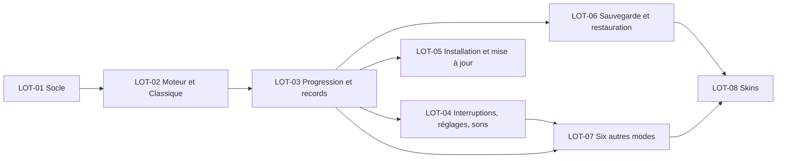

# Plan de réalisation — Serpent Cosmique

| Version | Date | Sources |
|---|---|---|
| 1.0 | 2026-11-01 | 02 v1.0, 03 v1.0, 04 (cadrage) |
| 1.1 | 2026-11-02 | 02 v1.1, 03 v1.1 : EF-29 allouée à LOT-05 ; critères de LOT-05 (EF-29, plafond de 10 Ko d'ENF-09) et de LOT-06 (limite de 262 144 octets de RG-72) complétés. Les règles modifiées (RG-10, RG-63, RG-64, RG-68, RG-72, RG-81, RG-85, ENF-09, ENF-16) restent dans les lots qui les portaient : découpage inchangé |
| 1.2 | 2026-11-02 | Revue de conception de sécurité (04 § 2.4, § 2.5) et 03 v1.2 : EXS-17, EXS-18, EXS-19 et EXS-20 allouées (LOT-01, LOT-03, LOT-05, LOT-06) avec leurs critères de fin ; gitleaks par binaire à empreinte vérifiée ou image épinglée ; vérification obligatoire de l'origine dédiée avant la première publication (LOT-05) ; analyse d'accessibilité `@axe-core/playwright` exigée sur chaque écran de 05 livré par un lot. Découpage inchangé |

## 1. Stratégie
- **Huit lots, réalisés un par un, dans l'ordre.** Le socle d'abord (LOT-01), puis une partie Classique jouable de bout en bout (LOT-02). Viennent ensuite la progression, qui rend les parties durables (LOT-03), l'intégration au téléphone (LOT-04) et l'installation hors ligne (LOT-05), qui rend le jeu installable sur le S22 dès que l'essentiel est là. Suivent la sauvegarde (LOT-06), les six autres modes (LOT-07) et les skins (LOT-08).
- **Chaque lot livre un incrément testable** : la suite complète (unitaires et acceptation) est verte à la fin de chaque lot et le jeu se construit et se lance.
- **La sécurité est intégrée aux lots concernés** : les règles d'analyse statique et la politique CSP dès LOT-01, le validateur unique dès LOT-03, l'intégrité de la distribution dans LOT-05, le corpus piégé dans LOT-06. Aucune exigence de sécurité n'est reportée en fin de réalisation.
- **Règles communes à tous les lots** :
  - tests écrits avant le code ; chaque critère d'acceptation (CA) des EF du lot est vérifié par au moins un test automatisé, unitaire sur `src/core` (graine et temps simulés) ou d'acceptation Playwright ;
  - `npm run lint` (ESLint et Prettier), `npm run typecheck`, `npm test` (couverture de lignes de `src/core` d'au moins 80 %), `npm run build` et `npm run test:e2e` sans erreur ni avertissement ;
  - aucune dépendance hors du § 11 de 03 ; aucune valeur de règle hors de `src/core/rules.ts` (ENF-19) ; tout texte affiché dans `src/ui/texts.ts`, en français (ENF-13) ;
  - aucun `TODO`, code commenté ou code mort ; erreurs gérées explicitement, messages en français avec leur code ;
  - chaque écran de 05 livré ou modifié par le lot passe l'analyse `@axe-core/playwright` (règles WCAG 2.0, 2.1 et 2.2, niveaux A et AA) sans violation d'impact « serious » ni « critical », sur les profils « Android paysage » et « iPhone SE paysage » ; les écrans visés sont nommés dans les critères de chaque lot ;
  - revue de code approuvée.
- **Ce qui ne s'automatise pas** (vérifications sur le S22 et sur un iPhone, 03 § 9) est préparé dans les lots, puis vérifié en recette.

## 2. Lots

### LOT-01 — Socle technique
- **Objectif** : dépôt qui se construit, se teste et s'analyse de bout en bout. Il comprend une coquille d'application qui affiche le menu principal, les valeurs des règles centralisées, l'aléa à graine, la politique de sécurité du contenu, les règles d'analyse statique de sécurité et la CI de base. Journalisation : aucune, par décision (03 § 8) ; les messages sont centralisés dans `texts.ts`.
- **Exigences couvertes** : ENF-13, ENF-19, EXS-01, EXS-02, EXS-06, EXS-07, EXS-10, EXS-11, EXS-17 (`?seed=`, manifeste), EXS-18, EXS-20 (`.npmrc`, `ci.yml`, Dependabot).
- **Périmètre** : `package.json` (versions exactes, dont `@axe-core/playwright` 4.14.0, `overrides` minimatch, scripts `build`, `lint`, `typecheck`, `test`, `test:e2e`, `serve`, sans script `pre` ni `post`), `package-lock.json`, `.npmrc` (`ignore-scripts=true`), `.nvmrc` (22), `tsconfig.json`, `eslint.config.js` (règles du § 6 de 03 : `no-eval`, `no-new-func`, `no-implied-eval`, `no-console`, restrictions sur `innerHTML`, `outerHTML`, `insertAdjacentHTML`, `document.write`, `fetch`, `XMLHttpRequest`, `WebSocket`, `EventSource`, `sendBeacon` et les API à permission), `.prettierrc.json`, `.prettierignore`, `.semgrep.yml`, `.editorconfig`, `.gitignore`, `playwright.config.ts` (profils « Android paysage » et « iPhone SE paysage » ; Chromium en local, Chromium et WebKit en CI), `scripts/build.mjs`, `scripts/serve.mjs` (EXS-18), `scripts/make-icons.mjs`, `public/index.html` (CSP en premier élément de `<head>`, `no-referrer`, `noindex`, `viewport-fit=cover`), `public/styles.css`, `public/manifest.webmanifest` (sans `share_target`, `file_handlers`, `protocol_handlers` ni `launch_handler`), `public/robots.txt`, `public/icons/*`, `src/main.ts` (refus d'un cadre), `src/core/rules.ts` (grille, couleurs, silhouettes, modes, limites du dictionnaire, conversion mm), `src/core/random.ts` (avec l'analyse stricte de `?seed=`), `src/ui/dom.ts`, `src/ui/texts.ts`, `src/ui/screens/menu.ts`, `tests/unit/random.test.ts`, `tests/unit/rules.test.ts`, `tests/acceptance/socle.spec.ts`, `tests/acceptance/serveur.spec.ts`, `.github/workflows/ci.yml`, `.github/dependabot.yml`.
- **Dépend de** : aucun
- **Complexité** : moyenne
- **Critères de fin** : critères d'acceptation couverts par des tests, suite de tests verte, revue de code approuvée, et :
  - `npm ci` puis toutes les commandes du § 1 réussissent sur une copie propre du dépôt ;
  - le menu principal (« Jouer », « Records », « Skins », « Réglages », « Sauvegarde ») s'affiche en paysage ; aucune violation CSP pendant le chargement ; le test compte 0 requête vers une autre origine et 0 requête émise par la page après le chargement ;
  - un test vérifie que la configuration ESLint signale `innerHTML`, `document.write`, `eval`, `new Function` et `fetch` dans des fichiers d'essai ; Semgrep (règles locales) ne signale rien sur `src/` ;
  - deux suites de tirages avec la même graine sont identiques, et différentes avec une autre graine ;
  - `npm audit` sans vulnérabilité ; la CI a `permissions: contents: read`, des actions épinglées par SHA, `actions/checkout` avec `persist-credentials: false`, aucune expression de contexte GitHub dans un `run:`, et `npm ci` partout ;
  - gitleaks sur tout l'historique, par son binaire publié dont la somme SHA-256 est vérifiée ou par son image épinglée par condensat, jamais par `gitleaks-action` ; Semgrep (`pip` ou `uvx`) à version fixe ; osv-scanner par le workflow réutilisable officiel épinglé par SHA ; Dependabot pour `npm` et `github-actions` avec `cooldown` de 7 jours ; `.npmrc` contient `ignore-scripts=true` ;
  - `?seed=` (EXS-17) : `?seed=42` rejoue la même partie ; `?seed=abc`, `?seed=-1`, `?seed=99999999999` et `?seed=4294967296` sont ignorés sans message ; un autre paramètre ou un fragment d'adresse n'a aucun effet ; le manifeste ne déclare aucun des quatre champs interdits ;
  - `serve.mjs` (EXS-18) : `/..%2f..%2fpackage.json`, `/%2e%2e/`, un octet nul et un lien symbolique sortant de `dist/` donnent 404 ; `Host: exemple.test` donne 421 ; `POST` est refusé ; aucune liste de répertoire ; aucun en-tête de sécurité ajouté ; écoute sur 127.0.0.1 seulement ;
  - analyse axe sans violation sérieuse ou critique sur E1 Menu principal ;
  - aucune mention interdite ni lien sortant du dépôt.

### LOT-02 — Moteur de jeu et mode Classique
- **Objectif** : une partie Classique complète, jouable au glissement et aux flèches. Elle comprend les couleurs et l'arc-en-ciel, la file de commandes, la collision, la victoire, la pause manuelle (bouton et retour du téléphone), la reprise avec compte à rebours, l'abandon, l'orientation et un écran de fin. Records et compteurs arrivent en LOT-03.
- **Exigences couvertes** : EF-01 (menu, liste des modes, Classique jouable), EF-02 (sauf RG-10, en LOT-04), EF-03, EF-04, EF-05, EF-06, EF-07, EF-08, EF-09, EF-16 (raison, score, « Rejouer », « Menu »), EF-25, EF-28, ENF-04, ENF-05 (lancement d'une partie en 1 s, changement d'écran en 0,5 s), ENF-06, ENF-07, ENF-08 (serpent jusqu'à 288 cases), ENF-10, ENF-11 (décor par défaut, bonbons, serpent dans les 4 couleurs et en arc-en-ciel), ENF-12, ENF-19.
- **Périmètre** : `src/core/types.ts`, `board.ts`, `commands.ts`, `engine.ts`, `scheduler.ts`, `color.ts`, `modes/classic.ts`, `src/ui/input.ts`, `layout.ts`, `src/ui/render/board.ts`, `decor.ts` (décor par défaut), `snake.ts` (forme par défaut), `candies.ts`, `hud.ts`, `src/ui/screens/modes.ts`, `game.ts`, `pause.ts`, `end.ts`, `src/platform/lifecycle.ts` (bouton retour, orientation), tests unitaires et `tests/acceptance/classique.spec.ts`.
- **Dépend de** : LOT-01
- **Complexité** : élevée
- **Critères de fin** : critères d'acceptation couverts par des tests, suite de tests verte, revue de code approuvée, et :
  - chaque CA d'EF-02, EF-03, EF-04, EF-05, EF-06, EF-07, EF-08, EF-09, EF-25 et EF-28 a son test. Les règles sont testées sur le moteur avec graine (400 bonbons de couleurs équilibrées, 100 apparitions avec un serpent de 200 cases, victoire sur une aire presque pleine). Les gestes sont testés par Playwright : glissement de 1 cm, toucher bref, diagonale, flèches avec retour visuel, deux commandes rapides, demi-tour, bouton retour qui met en pause sans fermer ;
  - ordonnanceur : sur des images simulées à 60 Hz et à 120 Hz, 95 % des intervalles entre deux pas sont à ± 10 % de l'intervalle nominal et aucun ne dépasse le double ; aucun pas rattrapé après une reprise ;
  - contrastes calculés sur la palette : au moins 3:1 entre le décor par défaut et chaque élément de jeu, au moins 4,5:1 pour les textes ; arc-en-ciel d'au moins 5 couleurs, sans zone qui change plus de 3 fois par seconde ;
  - disposition : sur les profils « Android paysage » et « iPhone SE paysage », la grille 24 × 12 est entière dans la zone sûre, aucune flèche ne la recouvre, et les cases atteignent les tailles minimales calculées (03 § 3.2) ;
  - du menu principal au compte à rebours en exactement 2 touchers ;
  - analyse axe sans violation sérieuse ou critique sur E2 Choix du mode, E3 Partie (bandeau, bouton pause, flèches), E4 Compte à rebours, E5 Pause et abandon, E6 Fin de partie et E12 Tournez votre téléphone.

### LOT-03 — Progression locale, records et partie interrompue
- **Objectif** : progression durable et sûre : compteurs, tableaux des records, saisie du nom, clôture d'une partie interrompue, repli sur la dernière version lisible. Ce lot crée aussi le catalogue et l'évaluation des déblocages de skins, nécessaires au validateur et à la fin de partie, et le module unique de validation.
- **Exigences couvertes** : EF-16 (compteurs, « Nouveau record ! », déblocages annoncés, enregistrement avant affichage), EF-17, EF-18, EF-19 (catalogue, conditions, déblocage définitif, annonce RG-58 ; rendu en LOT-08), EF-27, ENF-08 (70 records, compteurs jusqu'à 1 000 000 000), ENF-14, ENF-16 (E-05), EXS-04 (validation de la progression locale et de la partie en cours), EXS-05 (écriture atomique), EXS-06 (nom affiché comme texte), EXS-12, EXS-13, EXS-14, EXS-17 (compléments du validateur, prédicat de caractères partagé avec la saisie du nom).
- **Périmètre** : `src/core/records.ts`, `skins.ts`, `progress.ts`, `validation.ts`, `savefile.ts` (enveloppe, sérialisation canonique, SHA-256), `format.ts` (JJ/MM/AAAA, nombres en français), `src/platform/storage.ts`, `src/ui/screens/records.ts`, `end.ts` (saisie du nom, annonces), `src/main.ts` (lecture au démarrage, partie interrompue, E-05), tests unitaires et `tests/acceptance/progression.spec.ts`.
- **Dépend de** : LOT-02
- **Complexité** : élevée
- **Critères de fin** : critères d'acceptation couverts par des tests, suite de tests verte, revue de code approuvée, et :
  - chaque CA d'EF-16, EF-17, EF-18, EF-19 (sauf CA-3, en LOT-06) et EF-27 a son test, dont : score égal au 10e refusé, score de 0 jamais inscrit, `<script>Coco` affiché littéralement, `` tronqué à 12 caractères et affiché sans exécution, emoji compté pour un caractère, U+202E retiré ;
  - 20 fermetures forcées simulées (fermeture du contexte navigateur pendant une partie, juste après un record, juste après un réglage) : aucune perte d'une donnée enregistrée ; partie interrompue comptée une seule fois après deux réouvertures ;
  - progression locale corrompue (caractère modifié, JSON tronqué, clé `__proto__`) : la dernière version lisible est reprise ; les deux emplacements corrompus donnent les valeurs par défaut et E-05 ; `Object.prototype` reste inchangé ;
  - l'écran de fin ne s'affiche qu'après la fin de la transaction d'écriture ; `navigator.storage.persist()` est appelé ;
  - la règle ESLint qui interdit `Object.assign`, la décomposition d'objet et les clés calculées est active sur `validation.ts` et `merge.ts` (vérifiée par un fichier d'essai) ;
  - jeu de données maximal (7 tableaux pleins, noms de 12 caractères, compteurs à 1 000 000 000) chargé et affiché sans erreur ;
  - compléments d'EXS-17 sur la progression locale : 100 000 crochets imbriqués, substitut isolé dans un nom, U+200F ou U+061C dans un nom, `records` ou `data` sous forme de tableau sont refusés sans exception non captée ; un emoji composé avec U+200D est accepté ;
  - un nom saisi contenant U+200F, U+202E ou un substitut isolé est nettoyé à la saisie par le même prédicat que le validateur ; après rechargement, la progression est relue sans repli ni E-05 ;
  - analyse axe sans violation sérieuse ou critique sur E6 Fin de partie (saisie du nom), E7 Records et E13 Messages au lancement.

### LOT-04 — Interruptions, réglages, sons et vibrations
- **Objectif** : intégrer le jeu au téléphone : pause automatique à chaque perte du premier plan, écran maintenu allumé, réglages durables, bruitages, musique et vibrations conformes aux réglages, sans aucune permission.
- **Exigences couvertes** : EF-02 (RG-10), EF-21 (sauf RG-64, en LOT-05), EF-22, EF-26, ENF-17, EXS-03 (API sans permission).
- **Périmètre** : `src/platform/lifecycle.ts` (`visibilitychange`, `pagehide`, `blur`, orientation verticale, Screen Wake Lock), `audio.ts` (bruitages de RG-66 pour tous les événements, y compris ceux des modes de LOT-07 ; musique en boucle), `haptics.ts`, `src/ui/screens/settings.ts`, `src/core/progress.ts` (réglages), tests unitaires et `tests/acceptance/interruptions.spec.ts`.
- **Dépend de** : LOT-03
- **Complexité** : moyenne
- **Critères de fin** : critères d'acceptation couverts par des tests, suite de tests verte, revue de code approuvée, et :
  - chaque CA d'EF-21 (sauf RG-64), EF-22 et EF-26 a son test. La perte du premier plan est simulée : la pause intervient au plus 1 pas après l'événement, le chrono ne bouge pas et aucun mouvement n'a lieu avant « Reprendre ». Musique arrêtée hors premier plan ; réglages conservés après rechargement ; réglage des vibrations grisé quand `navigator.vibrate` est absent ;
  - verrou d'écran demandé pendant une partie en cours, relâché en pause, redemandé au retour au premier plan, sans erreur quand l'API est absente ;
  - analyse axe sans violation sérieuse ou critique sur E9 Réglages, y compris le réglage des vibrations grisé ;
  - inventaire des API appelées par le code (recherche statique et règle ESLint) : seules `vibrate`, `wakeLock`, `storage.persist` et les API de fichier ; aucune invite d'autorisation pendant les tests.

### LOT-05 — Installation hors ligne, mise à jour consentie et publication
- **Objectif** : le jeu s'installe depuis le téléphone, fonctionne sans réseau et ne change de version que sur consentement du joueur. Chaque version est publiée par la CI avec son archive, ses sommes de contrôle et sa SBOM.
- **Exigences couvertes** : EF-21 (RG-64 « À propos »), EF-29, ENF-01, ENF-02, ENF-03, ENF-05 (démarrage à froid), ENF-09, ENF-18, EXS-01 (publication sans secret stocké), EXS-02 (agent de service en cache seul), EXS-08, EXS-09, EXS-11 (tâches de publication et leurs permissions), EXS-15 (`SECURITY.md` initial : lien officiel, absence de communication, mises à jour, authentification à plusieurs facteurs, origine dédiée), EXS-16, EXS-17 (agent de service), EXS-19, EXS-20 (`release.yml`).
- **Périmètre** : `src/sw/sw.ts`, `tsconfig.sw.json`, `scripts/build.mjs` (version, liste des fichiers et empreintes injectées dans `dist/sw.js`), `src/platform/install.ts`, `src/ui/screens/about.ts`, `install-help.ts`, repère de version sur `menu.ts`, `public/manifest.webmanifest`, `.github/workflows/release.yml`, `SECURITY.md`, `docs/guide-exploitation.md` (section « Avant la première publication », complétée ensuite avec le reste du guide), tests `tests/acceptance/installation.spec.ts` (deux constructions de versions différentes servies l'une après l'autre).
- **Dépend de** : LOT-03
- **Complexité** : élevée
- **Critères de fin** : critères d'acceptation couverts par des tests, suite de tests verte, revue de code approuvée, et :
  - après un premier chargement, « Prêt à jouer hors ligne » s'affiche. Hors ligne, serveur arrêté et navigateur relancé, le jeu s'ouvre et une partie, une sauvegarde de réglage et une fin de partie fonctionnent, avec 0 requête émise par la page ou par l'agent de service ;
  - chaque CA d'EF-29 a son test, avec deux constructions 1.0.0 et 1.1.0 servies l'une après l'autre. Sans toucher « Installer », la version 1.1.0 n'est pas appliquée, ni à la réouverture ni après fermeture de toutes les pages (CA-1) ; après « Installer », le message de RG-90 s'affiche et records, skins et réglages sont identiques (CA-2). Une connexion coupée pendant la mise à jour, ou un fichier dont l'empreinte est fausse, donne E-06 et laisse la version 1.0.0 utilisable hors ligne avec sa progression (CA-3). Rien ne s'affiche pendant une partie (CA-4). En mode avion, ni proposition ni erreur, et « Prêt à jouer hors ligne » est visible (CA-5) ;
  - ouvert dans le navigateur sans être installé, le jeu affiche le panneau « Installer le jeu » adapté à Android ou à iPhone (RG-92) ;
  - ENF-09 : `dist/sw.js` fait 9 Ko au plus ; l'échange d'une ouverture connectée (en-têtes et corps relevés par Playwright) fait 10 Ko au plus, que la version ait changé ou non ;
  - si `connect-src 'none'` bloque la mise à jour, la valeur `'self'` est rétablie et la décision est consignée dans 03 ;
  - le manifeste est reconnu installable par Chromium ; démarrage à froid depuis le cache mesuré sous 3 s sur le profil « Android paysage » ;
  - `release.yml` exécuté à blanc, sans publication, produit `serpent-cosmique-<version>.zip`, `SHA256SUMS` (vérifié par `sha256sum -c`) et une SBOM CycloneDX ; les permissions sont limitées par tâche ; aucun secret stocké n'est utilisé ;
  - `release.yml` (EXS-20) : une étiquette posée hors de `main` est refusée (`git merge-base --is-ancestor`) ; la publication attend une CI au vert sur le même commit ; aucun cache ; la tâche de construction n'installe aucun navigateur ; la version est créée par `gh release create` ; aucune expression de contexte GitHub dans un `run:` ; `scripts/build.mjs` échoue si `dist/` contient un fichier hors de la liste pré-cachée et de `sw.js`, ou s'il en manque un ;
  - agent de service (EXS-17) : une requête autre que `GET`, ou hors de son origine ou de sa portée, n'est pas servie depuis le cache ; une réponse redirigée, non `ok` ou d'empreinte fausse n'est pas mise en cache et fait échouer la mise à jour (E-06) ; un message quelconque envoyé par la page à l'agent reste sans effet ; aucun `fetch` hors de l'installation et de la mise à jour consentie (lecture de `sw.ts` et comptage des requêtes) ;
  - guide d'exploitation : la liste de contrôle « Avant la première publication » (EXS-19) commence par la vérification obligatoire qu'aucun autre site Pages n'est publié sur le compte, sinon publication depuis une organisation gratuite dédiée. Elle donne pour chaque réglage la commande `gh api` qui le contrôle. `SECURITY.md` indique le signalement privé des vulnérabilités, l'adresse IP reçue par GitHub et le risque accepté d'un site ajouté plus tard sur le compte ; il ne présente pas le consentement comme une protection contre une publication piégée ;
  - analyse axe sans violation sérieuse ou critique sur E1 Menu principal (repère de mise à jour, bandeau d'installation), E10 À propos (avec et sans proposition de mise à jour) et E14 Panneau « Installer le jeu » ;
  - « À propos » affiche « Serpent Cosmique », la version au format MAJEUR.MINEUR.CORRECTIF et « © CocoClaudo ».

### LOT-06 — Sauvegarde et restauration
- **Objectif** : créer un fichier de sauvegarde et le restaurer par fusion sur ce téléphone ou un autre, en refusant tout fichier abîmé, modifié ou piégé, sans jamais altérer la progression.
- **Exigences couvertes** : EF-19 (CA-3, déblocages après restauration), EF-23, EF-24, ENF-08 (fichier de 50 Ko au plus), ENF-15, ENF-16 (E-01, E-02, E-03, E-04), EXS-03 (sélecteur, partage, téléchargement), EXS-04 (fichier importé, corpus complet), EXS-05 (fusion), EXS-12, EXS-13, EXS-15 (`SECURITY.md` : contenu du fichier, prudence avec un fichier d'origine inconnue), EXS-17 (corpus complété, appliqué au fichier importé).
- **Périmètre** : `src/core/merge.ts`, `savefile.ts` (création, nom du fichier), `validation.ts` (contrôles du fichier), `src/platform/save-io.ts`, `src/ui/screens/save.ts`, `tests/fixtures/saves/*`, tests unitaires et `tests/acceptance/sauvegarde.spec.ts`, `SECURITY.md`.
- **Dépend de** : LOT-03
- **Complexité** : élevée
- **Critères de fin** : critères d'acceptation couverts par des tests, suite de tests verte, revue de code approuvée, et :
  - chaque CA d'EF-23 et EF-24 a son test ; E-03 est testé sur le chemin du sélecteur d'enregistrement (erreur `QuotaExceededError` simulée) ;
  - limite de RG-72 : un fichier de 262 145 octets est refusé sans que son contenu soit lu ; un fichier valide complété d'espaces jusqu'à 262 144 octets est accepté ;
  - corpus d'EXS-04 entièrement refusé, progression intacte : fichier vide, 10 Mo, binaire, image, JSON d'une autre application, JSON tronqué, somme fausse, version future (E-02), champ inconnu, clés `__proto__`, `constructor` et `prototype`, nombres négatifs, décimaux, `1e308`, `NaN`, `null`, 1 000 records, nom de 10 000 caractères, nom avec U+202E, skin inconnu, et compléments d'EXS-17 : 100 000 crochets imbriqués, substitut isolé dans un nom, U+200F dans un nom, `records` ou `data` sous forme de tableau ; tous donnent E-01, sans exception non captée ;
  - 10 000 mutations aléatoires reproductibles d'un fichier valide : aucune exception non gérée, aucune acceptée sans somme correcte ;
  - fusion : `Object.prototype` inchangé après import ; skins disjoints réunis ; 6 + 7 records dont 2 communs donnent les 10 meilleurs des 11 distincts ; seconde restauration sans effet ; échec d'écriture simulé, progression identique à l'état antérieur ;
  - contenu du fichier exactement conforme au schéma (aucun champ en plus) ; nom généré, suffixe `-2` pour une seconde sauvegarde dans la même minute ; nom du fichier importé ignoré ;
  - avec le jeu de données maximal : fichier de 50 Ko au plus, créé en 2 s au plus et restauré en 3 s au plus ;
  - analyse axe sans violation sérieuse ou critique sur E11 Sauvegarde (création, restauration, résumé et confirmation, messages E-01, E-02, E-03, E-04).

### LOT-07 — Modes Contre la montre, Champ d'astéroïdes, Trou noir, Bonus et pièges, Zen et Constellation
- **Objectif** : les six autres modes, avec leurs règles, leurs informations à l'écran, leurs sons et vibrations, et la découverte du mode mystère.
- **Exigences couvertes** : EF-01 (liste complète, emplacement « Mode mystère »), EF-10, EF-11, EF-12, EF-13, EF-14, EF-15, EF-16 (annonce « Nouveau mode découvert »), ENF-10 (règles de chaque mode en 2 phrases et 200 caractères), ENF-11 (astéroïdes, halos des trous noirs, pictogrammes), ENF-19, ENF-20.
- **Périmètre** : `src/core/modes/time-attack.ts`, `asteroids.ts`, `black-hole.ts`, `bonus-traps.ts`, `zen.ts`, `constellation.ts`, `src/core/rules.ts` (valeurs des modes), `src/ui/render/obstacles.ts`, `hud.ts` (chrono, effet en cours, constellation), `src/ui/screens/modes.ts`, `end.ts`, tests unitaires et `tests/acceptance/modes.spec.ts`.
- **Dépend de** : LOT-03 (compteurs du mode mystère), LOT-04 (vibration du bonbon spécial, sons des modes)
- **Complexité** : élevée
- **Critères de fin** : critères d'acceptation couverts par des tests, suite de tests verte, revue de code approuvée, et :
  - chaque CA d'EF-01, EF-10, EF-11, EF-12, EF-13, EF-14 et EF-15 a son test sur le moteur, avec graine et temps simulé. Cela comprend le chrono figé pendant 2 minutes de pause, 7 astéroïdes au 20e bonbon et jamais plus de 30, la téléportation et la collision à la sortie, le remplacement des effets et les durées figées en pause, la traversée des bords et du corps en Zen, et le calcul des points de Constellation ;
  - deux parties de recette rejouées avec la même graine et les mêmes commandes donnent les mêmes positions de bonbons, d'astéroïdes et de trous noirs ;
  - endurance automatisée : 2 heures de jeu simulé réparties sur les 7 modes, 50 cycles de pause et reprise, sans exception ni blocage ;
  - contrastes calculés pour les astéroïdes, les trous noirs et les pictogrammes sur le décor par défaut ;
  - analyse axe sans violation sérieuse ou critique sur E2 Choix du mode (7 modes, « Mode mystère » verrouillé puis découvert), E3 Partie (chrono, effet en cours, constellation à tracer) et E6 Fin de partie (annonce de découverte).

### LOT-08 — Skins : écran de choix et rendu
- **Objectif** : l'écran « Skins » et le dessin des 16 skins (formes, motifs, traînées, décors), toujours dans la couleur courante du serpent.
- **Exigences couvertes** : EF-04 (RG-18), EF-19 (rendu des skins débloqués), EF-20, ENF-11 (4 décors), ENF-12 (animations des traînées et des décors).
- **Périmètre** : `src/ui/render/snake.ts` (formes, motifs), `decor.ts` (4 décors, constellations du ciel), traînées, `src/ui/screens/skins.ts`, `src/core/skins.ts` (progression chiffrée des conditions), tests unitaires et `tests/acceptance/skins.spec.ts`.
- **Dépend de** : LOT-06 (déblocages après restauration), LOT-07 (conditions liées aux modes)
- **Complexité** : moyenne
- **Critères de fin** : critères d'acceptation couverts par des tests, suite de tests verte, revue de code approuvée, et :
  - chaque CA d'EF-20 a son test ; un skin verrouillé affiche sa condition et sa progression chiffrée (« 63 / 250 bonbons ») ; « Retirer » rend le skin par défaut ; choix conservé après rechargement ;
  - avec chaque forme et chaque motif, le serpent est rose au départ puis prend la couleur du bonbon. Les motifs n'emploient que des nuances de la couleur courante ou du blanc, et la traînée est dessinée sous les bonbons, les obstacles et le serpent (vérifié par lecture de pixels du canevas) ;
  - contrastes calculés sur chacun des 4 décors : au moins 3:1 pour chaque élément de jeu, au moins 4,5:1 pour les textes ; aucune animation qui change plus de 3 fois par seconde ;
  - analyse axe sans violation sérieuse ou critique sur E8 Skins (skins débloqués, verrouillés avec leur condition, choisis).

## 3. Allocation des exigences
| Exigence | Lot(s) |
|---|---|
| EF-01 | LOT-02, LOT-07 |
| EF-02 | LOT-02, LOT-04 |
| EF-03 | LOT-02 |
| EF-04 | LOT-02, LOT-08 |
| EF-05 | LOT-02 |
| EF-06 | LOT-02 |
| EF-07 | LOT-02 |
| EF-08 | LOT-02 |
| EF-09 | LOT-02 |
| EF-10 | LOT-07 |
| EF-11 | LOT-07 |
| EF-12 | LOT-07 |
| EF-13 | LOT-07 |
| EF-14 | LOT-07 |
| EF-15 | LOT-07 |
| EF-16 | LOT-02, LOT-03, LOT-07 |
| EF-17 | LOT-03 |
| EF-18 | LOT-03 |
| EF-19 | LOT-03, LOT-06, LOT-08 |
| EF-20 | LOT-08 |
| EF-21 | LOT-04, LOT-05 |
| EF-22 | LOT-04 |
| EF-23 | LOT-06 |
| EF-24 | LOT-06 |
| EF-25 | LOT-02 |
| EF-26 | LOT-04 |
| EF-27 | LOT-03 |
| EF-28 | LOT-02 |
| EF-29 | LOT-05 |
| ENF-01 | LOT-05 |
| ENF-02 | LOT-05 |
| ENF-03 | LOT-05 |
| ENF-04 | LOT-02 |
| ENF-05 | LOT-02, LOT-05 |
| ENF-06 | LOT-02 |
| ENF-07 | LOT-02 |
| ENF-08 | LOT-02, LOT-03, LOT-06 |
| ENF-09 | LOT-05 |
| ENF-10 | LOT-02, LOT-07 |
| ENF-11 | LOT-02, LOT-07, LOT-08 |
| ENF-12 | LOT-02, LOT-08 |
| ENF-13 | LOT-01 |
| ENF-14 | LOT-03 |
| ENF-15 | LOT-06 |
| ENF-16 | LOT-03, LOT-06 |
| ENF-17 | LOT-04 |
| ENF-18 | LOT-05 |
| ENF-19 | LOT-01, LOT-02, LOT-07 |
| ENF-20 | LOT-07 |
| EXS-01 | LOT-01, LOT-05 |
| EXS-02 | LOT-01, LOT-05 |
| EXS-03 | LOT-04, LOT-06 |
| EXS-04 | LOT-03, LOT-06 |
| EXS-05 | LOT-03, LOT-06 |
| EXS-06 | LOT-01, LOT-03 |
| EXS-07 | LOT-01 |
| EXS-08 | LOT-05 |
| EXS-09 | LOT-05 |
| EXS-10 | LOT-01 |
| EXS-11 | LOT-01, LOT-05 |
| EXS-12 | LOT-03, LOT-06 |
| EXS-13 | LOT-03, LOT-06 |
| EXS-14 | LOT-03 |
| EXS-15 | LOT-05, LOT-06 |
| EXS-16 | LOT-05 |
| EXS-17 | LOT-01, LOT-03, LOT-05, LOT-06 |
| EXS-18 | LOT-01 |
| EXS-19 | LOT-05 |
| EXS-20 | LOT-01, LOT-05 |
